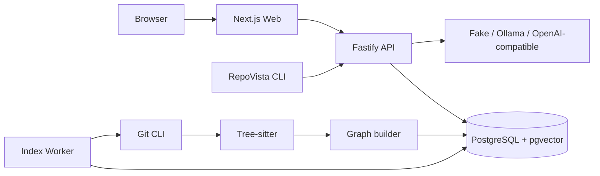

# 系统架构

状态：v0.1 已实现基线

## 1. 架构结论

RepoVista v0.1 是一个 TypeScript 模块化单体加独立索引 Worker：

- Next.js Web 提供导入、进度、架构地图、源码、问答和分享页。
- Fastify API 负责同步 HTTP、输入校验、检索和模型编排。
- Worker 通过 PostgreSQL 租约领取长时间索引任务。
- PostgreSQL 17 保存业务数据、源码 Blob、全文索引、图边、事件和引用。
- CLI 使用同一套公开 HTTP Contract。
- AI 是可替换解释层；静态索引不依赖模型。

v0.1 不需要 Redis、独立图数据库、对象存储、Kubernetes 或登录系统。

## 2. 运行拓扑



Compose 中有四个服务：`postgres`、`api`、`worker`、`web`。API 等待数据库健康并执行 Migration；Worker 等待 API 健康；Web 等待 API 健康。

## 3. 组件职责

### Web

- 只调用 `NEXT_PUBLIC_API_ORIGIN` 指向的 API。
- 用客户端组件管理仓库工作区交互状态。
- 使用 React Flow 展示包、文件和符号节点。
- 点击文件、图节点或引用时读取固定 Snapshot 的源码。
- 通过 SSE 加轮询恢复展示索引进度。

### API

- Zod 校验请求、路径、Ref、UUID 和 Query。
- 使用统一成功/失败信封与 `X-Request-ID`。
- 对匿名导入、问答和分享创建执行限流。
- 从 PostgreSQL 读取图、源码和检索证据。
- 调用模型后重新构建可信引用，而不是直接信任模型输出。
- 不执行 Clone、扫描或 Parser 长任务。

### Worker

- 使用 `FOR UPDATE SKIP LOCKED` 语义的存储层领取任务。
- 周期续租，并在每一主要阶段检查取消和租约归属。
- 创建临时目录、浅克隆、扫描文本、解析、建图、事务持久化。
- 成功、失败、取消或丢失租约后都清理临时工作区。

### PostgreSQL

- 是 v0.1 唯一持久化依赖和任务协调器。
- 用不可变 Snapshot 把结果绑定到 Commit。
- 用 `tsvector`、trigram 和结构化符号完成证据检索。
- `vector(1536)` 字段为后续 Embedding 路径保留；当前索引流程不生成向量。
- 源码按 SHA-256 内容寻址并内联在 `content_blobs`。

### 模型适配器

- `fake`：确定性证据摘要，不调用外部模型。
- `ollama`：调用 `${OLLAMA_BASE_URL}/v1/chat/completions`。
- `openai-compatible`：调用配置 Base URL 的 `/chat/completions`。
- 所有 Provider 都返回相同 Draft，之后统一执行证据 ID 校验。

## 4. Monorepo 依赖

```text
apps/web    -> contracts, ui, HTTP API
apps/cli    -> contracts, HTTP API
apps/api    -> ai, config, contracts, database, domain, git, graph, retrieval
apps/worker -> config, database, domain, git, graph, parser

packages/domain     不依赖框架
packages/contracts  HTTP/前端/CLI 共用 Zod 类型
packages/database   PostgreSQL Adapter 和 Migration
packages/git        URL、克隆和安全扫描
packages/parser     Tree-sitter TS/JS 解析
packages/graph      关系解析和多层视图
packages/retrieval  查询分词与 RRF 排序
packages/ai         Provider 和引用验证
```

Turborepo 保证共享包先构建；应用运行时使用各自的 `dist` 产物。

## 5. 一致性边界

- Snapshot 完成写入在数据库事务内完成。
- `repositories.latest_ready_snapshot_id` 只指向成功持久化的 Snapshot。
- 每个 Answer 和 Share Report 都记录明确的 `snapshot_id`。
- Job 由 `lease_owner` 与 `lease_expires_at` 防止多个 Worker 同时完成。
- Source API 只从该 Snapshot 的已持久化文件读取，不访问临时 Clone。

## 6. 安全边界

- 只接受公共 HTTPS GitHub URL，拒绝 URL 凭据、Query 和 Fragment。
- Git 禁用 Hook、系统配置、交互提示和非 HTTPS 协议。
- Scanner 拒绝符号链接，跳过二进制、超大文件和常见密钥文件。
- 用户 Ignore 与 Source Path 必须是安全的仓库相对路径。
- 仓库文本在模型 Prompt 中被明确标记为不可信数据。
- 返回 Citation 时只使用服务端已检索 Evidence 的位置和内容。

Worker 不是面向恶意多租户的完整沙箱。互联网部署仍需容器、网络和数据库访问控制。

## 7. v0.1 明确不包含

- 私有仓库、OAuth、PAT 或用户身份认证。
- RLS 强制、多工作区 UI 或企业权限。
- 对象存储和导出文件管线。
- Python、Go 等额外 Parser。
- 增量索引、GitHub Webhook、PR 影响分析。
- Embedding 生成与向量召回。

这些能力进入 Roadmap，不应被当前文档或产品页面描述为已经可用。
