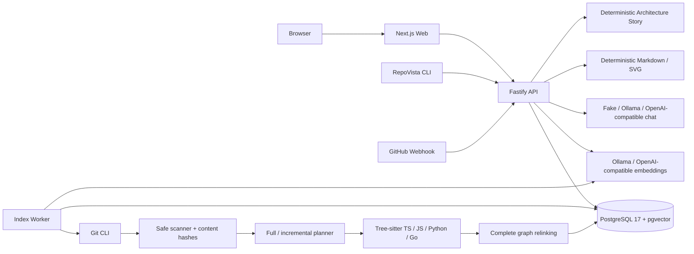

# 系统架构

状态：v0.4 已实现并验收（2026-08-20）

## 1. 架构结论

RepoVista 是一个以 TypeScript 实现的模块化单体，加一个独立索引/Embedding Worker。它分析
TypeScript、JavaScript、Python 和 Go 公共仓库：

- Next.js Web 提供导入、任务进度、Snapshot Delta、架构地图、源码、PR Impact、四模式检索、
  可信问答、导出和 Architecture Story。
- Fastify API 负责同步 HTTP、输入校验、Webhook 验签、透明检索、Chat/Embedding 编排和确定性
  Story/导出。
- Worker 通过 PostgreSQL 租约领取长时间任务，执行安全 Clone、扫描、增量计划、解析、图持久化
  和可恢复的 Embedding Batch。
- PostgreSQL 17 保存业务数据、源码 Blob、不可变 Snapshot、全文索引、图边、任务事件、引用和
  Webhook Delivery，以及 Snapshot 派生的版本化 Vector Index。
- CLI 使用同一套公开 HTTP Contract。
- Chat AI 是可替换解释层；静态索引、地图、源码、Text/Symbol Search、Impact、Story 和
  Markdown/SVG 导出都不依赖模型。Semantic Search 仅在显式配置真实 Embedding Provider 后启用。

当前架构不需要 Redis、独立图数据库、对象存储、Kubernetes 或登录系统。减少基础设施不是
临时省略：任务状态、租约和业务事务必须共享同一个事实源。

## 2. 运行拓扑



Compose 有四个服务：`postgres`、`api`、`worker`、`web`。API 等待数据库健康并执行
Migration；Worker 和 Web 等待 API 健康。Webhook 和模型 Provider 是外部能力，不额外引入
Compose 服务。

## 3. 组件职责

### Web

- 只调用 `NEXT_PUBLIC_API_ORIGIN` 指向的 API。
- 用固定 `snapshotId` 驱动 Repository Workspace，避免页面漂移到后续 Snapshot。
- 使用 React Flow 展示包、文件和符号节点。
- 点击文件、图节点或引用时读取当前 Snapshot 的源码。
- 通过 SSE 加轮询恢复展示任务进度和 Worker Message。
- 展示 Full/Incremental/Legacy 状态、基线、解析与复用计数、Webhook 能力和更新时间。
- 提供 Evidence Retrieval Lab，公开 Text/Symbol/Semantic/Hybrid 通道、Rank、Raw Score、降级原因
  和 Embedding Index 状态。
- 渲染固定 Base/Head 的 PR Impact，以及固定 Snapshot 的 Architecture Story v1/v2。
- 直接链接当前 Snapshot 的 Markdown/SVG 下载 Endpoint，不把导出正文塞入 React State。

### API

- 使用 Zod 校验请求、路径、Ref、UUID、Query 和 Webhook Payload。
- 使用统一成功/失败信封与 `X-Request-ID`；Health 和附件正文是明确例外。
- 对匿名导入、问答和分享创建执行限流。
- 从 PostgreSQL 读取图、源码和检索证据。
- 为当前配置创建/复用 Embedding Profile；Semantic Query 生成真实 Query Vector，Hybrid 在上游
  失败时保留 Lexical 结果并公开降级 Trace。
- 调用模型后重新构建可信引用，不信任模型自由生成的路径、行号或 Quote。
- 对 GitHub 原始 Body 做 HMAC-SHA256 验签，再解析和筛选事件。
- 为 Ready Snapshot 即时生成确定性 Markdown/SVG，并生成/保存 Story v2 JSON。
- 不执行 Clone、扫描或 Parser 长任务。

### Worker

- 使用 `FOR UPDATE SKIP LOCKED` 语义的 Store 领取任务并周期续租。
- 在 Clone、扫描、解析批次、重新链接和持久化前检查取消与租约归属。
- 扫描完整目标 Commit，以 `path + content_hash` 与兼容基线比较。
- 复用未变化且解析成功的 ParsedFile，只解析新增或变化的受支持文件。
- 对复用与新解析结果执行完整跨文件重新链接，避免陈旧 Import Edge。
- 事务持久化自包含的新 Snapshot；查询时不回溯基线拼装结果。
- 对 `embed_snapshot` Job 按稳定 Chunk 顺序分批调用 Provider；校验条数、有限数值、非零范数和
  维度，持久化 Partial Batch，并在崩溃/租约过期后继续缺失 Chunk。
- 成功、失败、取消或丢失租约后都清理临时工作区。

### PostgreSQL

- 是唯一持久化依赖和任务协调器。
- 用不可变 Snapshot 把源码、图、问答、分享和导出来源绑定到 Commit。
- 用 `tsvector`、trigram、结构化符号和固定 Profile 内的 pgvector Cosine Distance 完成证据检索。
- 用内容哈希跨 Snapshot 复用 `content_blobs`，同时保留 Snapshot-local File/Symbol/Edge/Chunk。
- 保存增量基线、模式、Tree Hash 和统计，以及 Webhook Delivery 的幂等审计。
- `snapshot_embedding_indexes`、`code_chunk_embeddings` 与 Job FK 保存 Provider/Model/Input Version、
  可变 Dimension、Chunk Hash 和完整进度；旧 `code_chunks.embedding vector(1536)` 仅保留兼容。

### 模型、Embedding、Story 与导出适配器

- `fake`：确定性证据摘要，不调用外部模型。
- `ollama`：调用 `${OLLAMA_BASE_URL}/v1/chat/completions`。
- `openai-compatible`：调用配置 Base URL 的 `/chat/completions`。
- 所有模型 Provider 返回统一 Draft，之后执行服务端 Evidence ID 校验。
- `packages/embeddings` 独立调用 Ollama `/api/embed` 或 OpenAI-compatible `/embeddings`；Chat 与
  Embedding 配置互不暗示。
- `packages/story` 只消费固定 Snapshot Graph Data，用确定性算法生成热点、阅读路线和 Evidence。
- `packages/exporter` 是无框架、无数据库、无网络依赖的纯生成器，只消费已经验证的数据。

## 4. Monorepo 依赖

```text
apps/web    -> contracts, ui, HTTP API
apps/cli    -> contracts, HTTP API
apps/api    -> ai, config, contracts, database, domain, embeddings, exporter, git, graph, retrieval, story
apps/worker -> config, contracts, database, domain, embeddings, git, graph, parser

packages/domain     框架无关领域错误与静态分析类型
packages/contracts  HTTP、前端、CLI 共用 Zod 类型和 Parser Version
packages/database   PostgreSQL Store、Migration 和事务边界
packages/git        URL、Clone、安全扫描和语言识别
packages/parser     Tree-sitter TS/JS/Python/Go Adapter
packages/graph      跨文件关系解析和多层视图
packages/embeddings Ollama/OpenAI-compatible 协议、输入构造与 Vector 校验
packages/retrieval  通道选择、查询分词与稳定 RRF 排序
packages/story      Architecture Story v2 纯函数
packages/ai         Provider 和引用验证
packages/exporter   确定性 Markdown/SVG
packages/config     环境变量 Schema
packages/ui         可复用展示原语
```

Turborepo 保证共享包先构建；应用运行时使用各自的 `dist` 产物。

## 5. 一致性边界

- Snapshot 完成写入在一个数据库事务中完成。
- `repositories.latest_ready_snapshot_id` 只指向成功持久化的 Snapshot。
- 增量基线必须属于同一 Repository、状态 Ready 且 Parser Version 完全相同。
- 每个 Ready Snapshot 都包含完整 File/Symbol/Edge/Chunk 集合，`base_snapshot_id` 只记录来源。
- 每个 Answer、Share Report 和下载请求都绑定明确的 `snapshot_id`。
- Job 由 `lease_owner` 与 `lease_expires_at` 防止多个 Worker 同时完成。
- 同一 Snapshot/Provider/Model/Input Version 只有一个 Embedding Profile/Job；只有有效 Vector 数量
  等于 Chunk 数且维度一致时 Profile 才能 Ready。
- Search 只在一个 Ready Profile 内比较 Vector；不同模型或 Dimension 不进入同一排序空间。
- `github_webhook_deliveries.delivery_id` 唯一；同 ID 不同 Body Hash 必须冲突。
- Markdown/SVG 主体只由排序后的 Snapshot 数据决定，相同输入得到相同内容和 ETag。

## 6. 安全边界

- 只接受公共 HTTPS GitHub URL，拒绝 URL 凭据、Query 和 Fragment。
- Git 禁用 Hook、系统配置、交互提示和非 HTTPS 协议。
- Scanner 拒绝符号链接，跳过二进制、超大文件和常见密钥文件。
- 用户 Ignore 与 Source Path 必须是安全的仓库相对路径。
- Webhook 使用原始请求体、恒定时间比较和配置的 Secret 验证签名。
- Webhook Payload 不能改变 Clone Host，也不会执行 Payload 中的任意 URL。
- 仓库文本在模型 Prompt 中被明确标记为不可信数据。
- Embedding URL、Header、Model 只来自服务配置；Path/源码只是 JSON Data，不能修改请求目标。
- 非有限、零范数、超维度、条数不符和维度漂移的 Provider 输出在写库前拒绝。
- Citation 只使用服务端已检索 Evidence 的位置和内容。
- SVG 转义仓库控制文本，设置附件、`nosniff` 与 Sandbox CSP，并限制节点数。

Worker 不是面向恶意多租户的完整沙箱。互联网部署仍需容器隔离、出口限制、反向代理、
数据库访问控制和 Secret 管理。

## 7. v0.4 明确不包含

- 私有仓库、GitHub Installation Token、OAuth、PAT 或用户身份认证。
- RLS 强制、多工作区 UI 或企业权限。
- 对象存储、导出历史、PDF/PNG 导出。
- Rust、Java 等额外 Parser。
- 增量 Git Worktree 扫描、跨 Snapshot 查询 Overlay、跨模型全局 ANN Index 或独立 Vector DB。
- 自动下载/捆绑模型权重、自动性能扩缩容或把测试 Provider 伪装成真实 Semantic Search。
- 自动修改仓库、创建 Commit、Issue、PR 或评论。

这些边界不能在 README、产品页面或演示中写成已经可用。
