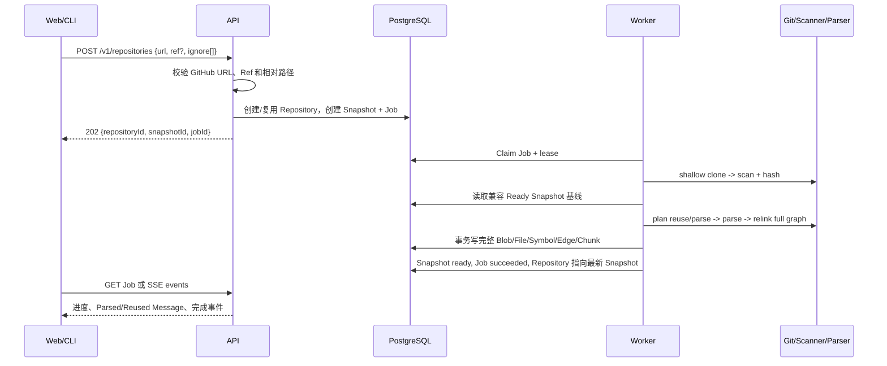
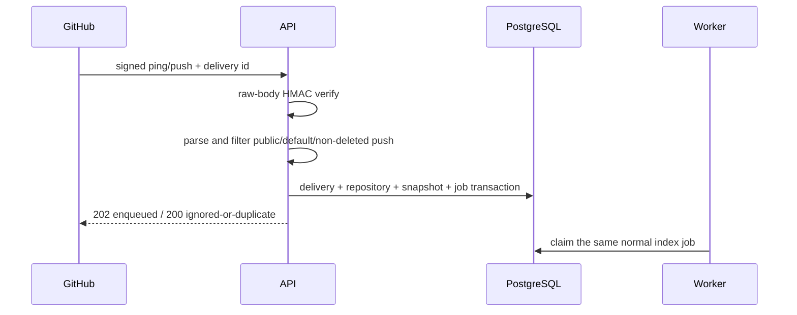

# 领域模型与数据流

状态：v0.2 已实现并验收（2026-08-20）

## 1. 核心对象

| 对象 | 含义 | 关键不变量 |
|---|---|---|
| Repository | 公共 GitHub 仓库身份 | Public Workspace 内按 canonical URL 唯一 |
| Snapshot | 一次不可变索引结果 | Ready 后绑定完整 Commit、Parser Version、Tree Hash 和完整数据集 |
| Analysis Job | Snapshot 的异步执行记录 | 只有持有有效租约的 Worker 可以写终态 |
| Snapshot File | Snapshot 中的文本文件 | `(snapshot_id, path)` 唯一，Path 不能逃逸 |
| Content Blob | SHA-256 内容寻址源码 | 相同内容可跨 Snapshot 复用 |
| Symbol | Parser 提取的模块或声明 | `(snapshot_id, stable_key)` 唯一并带源码范围 |
| Symbol Edge | contains/imports/calls/extends 等关系 | 必须有已解析目标或未解析文本目标之一 |
| Code Chunk | 可检索证据块 | 带 Snapshot、文件、可选 Symbol 和内容哈希 |
| Message/Citation | 问题、答案和可信引用 | Citation 必须来自同一 Snapshot 的服务端 Evidence |
| Share Report | 公开阅读导览 | 固定 Repository、Snapshot 与生成内容版本 |
| Webhook Delivery | GitHub 事件幂等审计 | Delivery ID 唯一；Payload Hash 不允许冲突 |
| Export Artifact | 即时生成的 Markdown/SVG | 不持久化，固定 Ready Snapshot 并可确定性重建 |

数据库保留 `users/workspaces/workspace_members` 作为未来演进边界。当前运行时只使用 Migration
创建的 Public Demo User 和 Public Workspace，没有登录、RLS 或按用户隔离的 HTTP 权限。

## 2. 手工导入与索引



相同仓库可以多次导入并产生多个 Snapshot。每个 Ready 结果保留原 Commit，因此仓库继续更新
也不会让旧地图、源码、引用、分享或下载漂移。

## 3. GitHub Webhook 自动更新



只有 Public Repository 的默认分支、非删除 Push 会入队。Ping、未知事件、私有仓库、非默认
分支和删除 Push 被安全忽略。同 Delivery 和相同 Body 返回既有结果；同 Delivery 配不同 Body
返回冲突，不能创建第二个 Job。

## 4. Snapshot 状态

```text
requested
  -> cloning
  -> scanning
  -> parsing
  -> building_graph
  -> ready

任意活动阶段 -> failed
任意活动阶段 -> cancelled
```

Contract 保留 `embedding` 状态，但 Worker 当前不进入该阶段。Job 使用
`queued/running/succeeded/failed/cancelled`，Snapshot 记录更细的分析阶段。

Ready Snapshot 额外满足：

- `commit_sha` 是实际 Checkout 的完整 SHA。
- v0.2 快照的 `parser_version` 是 `tree-sitter-ts-js-py-v1`；v0.3 新索引使用组合版本 `tree-sitter-ts-js-py-go-v1`。不同版本的快照继续可读，但不能互作增量基线。
- `index_mode` 为 `full` 或 `incremental`。
- `tree_hash` 由排序后的 Path 与 Content Hash 生成。
- `stats_json.indexing` 记录 scanned/changed/reused/parsed/deleted。
- Incremental 时 `base_snapshot_id` 指向实际复用的兼容基线。

旧 v0.1 Snapshot 继续可读，映射为 Full 且 `stats.indexing = null`；它们不会被组合 Parser
错误地当作 v0.2 增量基线。

## 5. 增量计划不变量

1. Worker 仍安全扫描目标 Commit 的完整文本集合。
2. Current 与 Base 使用 `path + content_hash + language + parse_status` 比较。
3. 未变化且基线已解析的受支持文件复用可还原 ParsedFile。
4. 新增、内容变化、语言变化或基线解析失败的受支持文件重新解析。
5. 不受 Parser 支持的文本文件仍持久化并建立 File Chunk。
6. 基线存在但当前不存在的 Path 只计入 Deleted，不进入新 Snapshot。
7. 合并复用与新解析结果后，完整重新解析跨文件关系。
8. 新 Snapshot 自包含，不在查询时读取 Base Snapshot 补数据。

## 6. 租约、恢复与取消

1. Worker 原子领取 `queued` 或租约过期的 `running` Job。
2. `lease_owner` 为当前 `WORKER_ID`，到期由 `JOB_LEASE_SECONDS` 控制。
3. Worker 后台续租，并在 Clone、扫描、解析批次、建图和持久化前检查。
4. Worker 崩溃后，租约过期，另一个 Worker 可以接管。
5. 旧 Worker 失去租约后不能完成、失败或取消该任务。
6. API Cancel 只设置取消请求；Worker 在 Checkpoint 转换为 cancelled。
7. 所有退出路径清理临时目录。

## 7. 地图、源码、搜索与导出

API 从 Snapshot-local File、Symbol 和 Edge 构建三种地图：

- `package`：按首级目录聚合文件关系。
- `file`：展示解析出的本地文件依赖。
- `symbol`：展示声明与 contains/imports/calls/extends 关系。

地图节点携带 `path` 和可选 `startLine/endLine`。Source 返回 Snapshot Commit、Blob Hash 和
实际行片段；Search 返回同 Snapshot 的 File/Symbol Evidence。

Markdown 和 SVG Endpoint 只接受 Ready Snapshot。API 读取 Repository、Snapshot、Graph 和
File Summary 后调用纯 Exporter，当次生成附件：

- Markdown 包含 Provenance、Delta、语言、地图和阅读路径。
- SVG 使用排序输入和确定性布局，转义 XML，最多输出 250 个节点。
- 两者不调用模型、不写导出表，也不切换到 Repository 最新 Snapshot。

## 8. 可信问答


模型不决定 Citation 的路径、行号和 Quote。服务端根据合法 Evidence ID 重建这些字段；没有
合法引用时答案降级为 `refused`。`fake` Provider 能在无模型密钥环境中演示完整可信链路。

## 9. 分享报告

创建 Share Report 时，API 读取 Ready Snapshot，生成包级地图和最多八个阅读入口并保存 JSON。
Slug 公开可读且固定到该 Snapshot。当前只处理公共仓库，因此没有私有仓库权限分支。

Share 与 Export 的区别是：Share 保存创建时的导览 JSON 并通过 Slug 公开读取；Export 每次从
同一个不可变 Snapshot 确定性重建附件。

## 10. ID、时间与命名

- 业务 ID 使用数据库层生成的 UUIDv7 兼容值。
- Job Event 使用单调递增 `bigserial`，支持 `after`/`Last-Event-ID` 恢复。
- GitHub Delivery ID 使用受长度限制的外部字符串主键。
- 时间统一为 PostgreSQL `timestamptz`，HTTP 输出 ISO 8601 UTC。
- 外部 API 使用 camelCase；数据库使用 snake_case。
