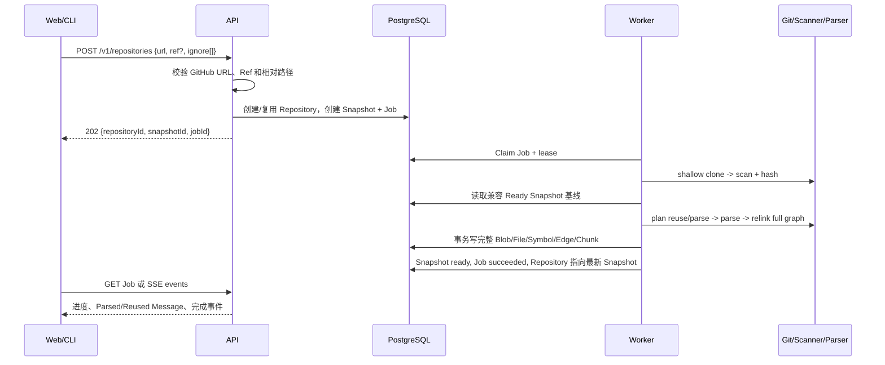
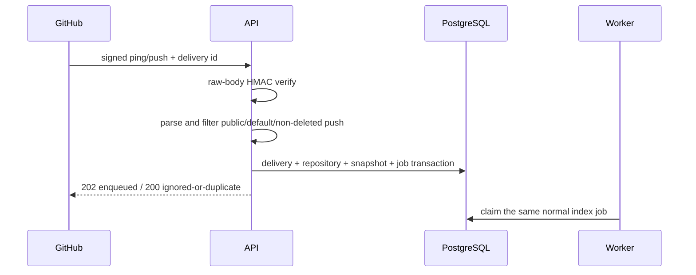
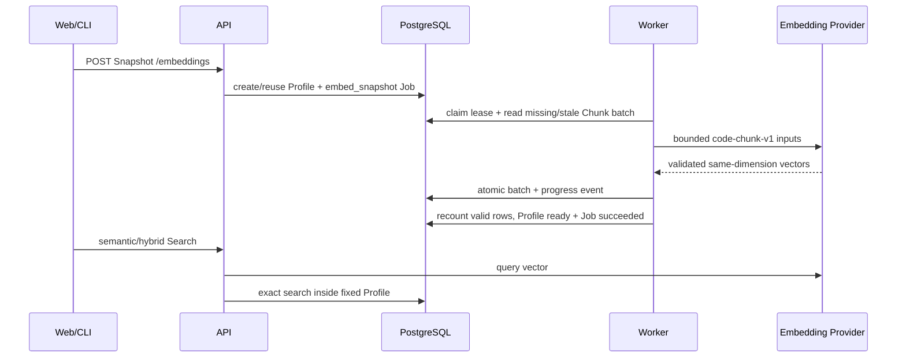
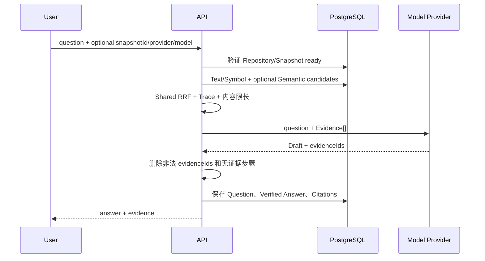
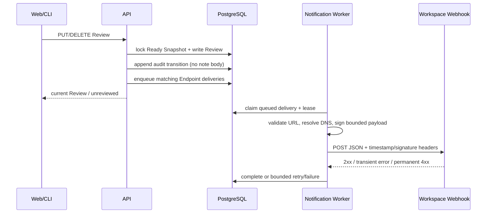
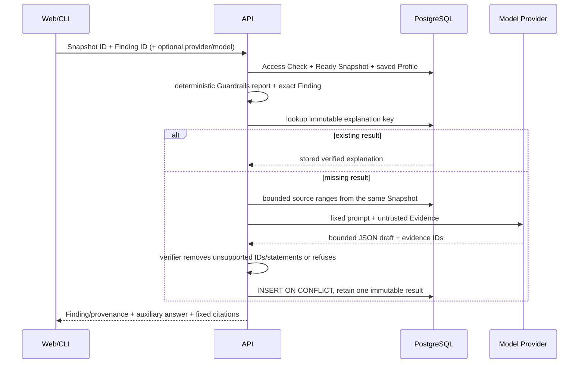

# 领域模型与数据流

状态：v1.3 已实现并验收（2026-08-28）

## 1. 核心对象

| 对象 | 含义 | 关键不变量 |
|---|---|---|
| Repository | 公共 GitHub 仓库身份 | Public Workspace 内按 canonical URL 唯一 |
| Snapshot | 一次不可变索引结果 | Ready 后绑定完整 Commit、Parser Version、Tree Hash 和完整数据集 |
| Analysis Job | Snapshot 的异步执行记录 | 只有持有有效租约的 Worker 可以写终态 |
| Snapshot File | Snapshot 中的文本文件 | `(snapshot_id, path)` 唯一，Path 不能逃逸 |
| Content Blob | SHA-256 内容寻址源码 | 相同内容可跨 Snapshot 复用 |
| Symbol | Parser 提取的模块或声明 | `(snapshot_id, stable_key)` 唯一并带源码范围 |
| Symbol Edge | contains/imports/calls/extends 等关系 | 必须有已解析目标或未解析文本目标之一 |
| Code Chunk | 可检索证据块 | 带 Snapshot、文件、可选 Symbol 和内容哈希 |
| Embedding Profile | Snapshot 的版本化派生语义索引 | Provider/Model/Input Version 唯一，Ready 前必须覆盖全部有效 Chunk |
| Chunk Embedding | 一个 Profile 中的 Chunk Vector | Snapshot/Profile/Chunk 归属、Content Hash、Input Hash 和 Dimension 必须一致 |
| Pull Request Analysis | 固定 Base/Head 的影响分析 | Revision 幂等，结果绑定双 Snapshot 和 Algorithm Version |
| Impact/Path/Evidence | Direct/Transitive/Unknown 影响事实 | 距离、风险、最短路径和 Quote 都固定到 Base/Head Commit |
| Message/Citation | 问题、答案和可信引用 | Citation 必须来自同一 Snapshot 的服务端 Evidence |
| Guardrail Profile | Workspace 内不可变阈值策略版本 | 只允许既有确定性规则的有界阈值，Snapshot 保存选择时的 Profile |
| Guardrail Explanation | 一个固定 Finding 的辅助说明 | Finding/provenance 由服务端固定，模型 Citation 必须通过 verifier；`subjectKey` 连接同 Repository 的逻辑历史 |
| Review History Entry | append-only 人审状态投影 | 只保留状态、备注长度、是否变化和操作者；不保存备注正文 |
| Notification Endpoint | Workspace 出站 Webhook 配置 | URL/事件订阅/启用状态受 Workspace Owner 管理；签名 Secret 不落库 |
| Notification Delivery | Review 事件的 durable outbox 行 | Endpoint+event key 幂等，带 lease、有限重试和投递状态 |
| Share Report | v1 Tour 或 v2 Architecture Story | 固定 Repository、Snapshot 与生成内容版本，Story 事实可确定性重建 |
| Webhook Delivery | GitHub 事件幂等审计 | Delivery ID 唯一；Payload Hash 不允许冲突 |
| Export Artifact | 即时生成的 Markdown/SVG | 不持久化，固定 Ready Snapshot 并可确定性重建 |

Public Demo 继续使用固定 User/Workspace；私有链路通过 GitHub Session、Workspace Role、API Token
和资源 Access Query 隔离。数据库未启用 RLS，所以 Store 查询必须显式限定 Workspace。

## 2. 手工导入与索引



相同仓库可以多次导入并产生多个 Snapshot。每个 Ready 结果保留原 Commit，因此仓库继续更新
也不会让旧地图、源码、引用、分享或下载漂移。

## 3. GitHub Webhook 自动更新



只有 Public Repository 的默认分支、非删除 Push 会入队。Ping、未知事件、私有仓库、非默认
分支和删除 Push 被安全忽略。同 Delivery 和相同 Body 返回既有结果；同 Delivery 配不同 Body
返回冲突，不能创建第二个 Job。

## 4. Snapshot 状态

```text
requested
  -> cloning
  -> scanning
  -> parsing
  -> building_graph
  -> ready

任意活动阶段 -> failed
任意活动阶段 -> cancelled
```

Contract 保留 `embedding` 状态，但 v0.4 的 Vector 是 Ready Snapshot 下的派生 Profile，不修改
Snapshot 的源码/图状态。Source Job 与 Embedding Job 都使用
`queued/running/succeeded/failed/cancelled`，并通过 `job_type` 与关联 FK 区分。

Ready Snapshot 额外满足：

- `commit_sha` 是实际 Checkout 的完整 SHA。
- v0.2 快照的 `parser_version` 是 `tree-sitter-ts-js-py-v1`；v0.3/v0.4 新索引使用组合版本
  `tree-sitter-ts-js-py-go-v1`。不同版本的快照继续可读，但不能互作增量基线。
- `index_mode` 为 `full` 或 `incremental`。
- `tree_hash` 由排序后的 Path 与 Content Hash 生成。
- `stats_json.indexing` 记录 scanned/changed/reused/parsed/deleted。
- Incremental 时 `base_snapshot_id` 指向实际复用的兼容基线。

旧 v0.1 Snapshot 继续可读，映射为 Full 且 `stats.indexing = null`；它们不会被组合 Parser
错误地当作 v0.2 增量基线。

## 5. 增量计划不变量

1. Worker 仍安全扫描目标 Commit 的完整文本集合。
2. Current 与 Base 使用 `path + content_hash + language + parse_status` 比较。
3. 未变化且基线已解析的受支持文件复用可还原 ParsedFile。
4. 新增、内容变化、语言变化或基线解析失败的受支持文件重新解析。
5. 不受 Parser 支持的文本文件仍持久化并建立 File Chunk。
6. 基线存在但当前不存在的 Path 只计入 Deleted，不进入新 Snapshot。
7. 合并复用与新解析结果后，完整重新解析跨文件关系。
8. 新 Snapshot 自包含，不在查询时读取 Base Snapshot 补数据。

## 6. 租约、恢复与取消

1. Worker 原子领取 `queued` 或租约过期的 `running` Job。
2. `lease_owner` 为当前 `WORKER_ID`，到期由 `JOB_LEASE_SECONDS` 控制。
3. Worker 后台续租，并在 Clone、扫描、解析批次、建图和持久化前检查。
4. Worker 崩溃后，租约过期，另一个 Worker 可以接管。
5. 旧 Worker 失去租约后不能完成、失败或取消该任务。
6. API Cancel 只设置取消请求；Worker 在 Checkpoint 转换为 cancelled。
7. 所有退出路径清理临时目录。

## 7. 地图、源码、透明检索与导出

API 从 Snapshot-local File、Symbol 和 Edge 构建三种地图：

- `package`：按首级目录聚合文件关系。
- `file`：展示解析出的本地文件依赖。
- `symbol`：展示声明与 contains/imports/calls/extends 关系。

地图节点携带 `path` 和可选 `startLine/endLine`。Source 返回 Snapshot Commit、Blob Hash 和
实际行片段；Search 返回同 Snapshot Evidence，并公开四种模式：

- `text`：Full-text + Path；
- `symbol`：Name/Qualified Name/Path Exact/Fuzzy；
- `semantic`：当前配置对应的 Ready Profile + Query Vector；
- `hybrid`：可用通道的稳定 RRF，Semantic 不可用时保留 Lexical 并返回降级原因。

每条 Hit 保存通道 Rank/Raw Score；Fusion 不直接相加不可比较的 Text/Cosine Score。

Markdown 和 SVG Endpoint 只接受 Ready Snapshot。API 读取 Repository、Snapshot、Graph 和
File Summary 后调用纯 Exporter，当次生成附件：

- Markdown 包含 Provenance、Delta、语言、地图和阅读路径。
- SVG 使用排序输入和确定性布局，转义 XML，最多输出 250 个节点。
- 两者不调用模型、不写导出表，也不切换到 Repository 最新 Snapshot。

## 8. Embedding Profile 生命周期



重复创建返回既有 queued/running/ready Job。失败重试保留 Hash 匹配的 Partial Vector；配置不匹配、
维度漂移、旧输入或非法输出不会静默复用。

## 9. 可信问答



Ask 与 `/search?mode=hybrid` 共用 Retriever，响应带同一类 Trace。模型不决定 Citation 的路径、
行号和 Quote；服务端根据合法 Evidence ID 重建这些字段。没有合法引用时答案降级为 `refused`。
`fake` Provider 能在无模型密钥环境中演示完整可信链路，但不会伪装成 Embedding Provider。

## 10. 分享报告

创建 Share Report 时，API 读取 Ready Snapshot 的 File/Symbol/Edge，生成 Architecture Story v2：
指标、包级地图、最多六个 Key Module、最多八个阅读入口、源码 Evidence 和 Provenance。Slug 公开
可读且固定到该 Snapshot；页面不在读取时重新调用 Provider。旧 `architecture_tour` v1 继续可读。

Share 与 Export 的区别是：Share 保存创建时的导览 JSON 并通过 Slug 公开读取；Export 每次从
同一个不可变 Snapshot 确定性重建附件。

## 11. Review 历史与 Signed Notification



Review history 查询从 `audit_events` 投影，并由当前 Snapshot Report 重算 `subjectKey` 后交叉过滤；
分页 Cursor 只暴露不透明的审计 ID。Outbox Payload 仅包含事件身份、Snapshot/Finding 身份、状态与
备注长度变化及操作者摘要。Worker 的 DNS/IP 检查、`redirect: error`、超时和 lease owner 校验共同
限制出站风险；部署平台仍需提供网络出口 Allowlist。

## 12. Verified Guardrail Explanation



AI 不参与 Finding、Severity、Fingerprint、Commit、Profile 或 Evidence 位置的选择。相同
Snapshot/Finding/provider/model/prompt 在调用模型前先查已有结果，数据库唯一键处理并发竞争。
解释可以被审查，但不替代 Guardrails JSON/SARIF 的确定性 CI 结论。

v1.0 的历史入口仍从当前 Snapshot 的精确 Finding 开始，由 API 计算 `subjectKey`，再在同一
Workspace/Repository 内读取不可变记录。历史与两条解释的结构比较不经过 Model Provider；比较仅对
provenance、Finding 和 Answer 的保存字段输出 `same/changed`。Base/Head Citation 始终使用各自
Explanation 保存的 Snapshot ID 打开固定源码，当前页面 Snapshot 不能替代历史 provenance。

## 13. ID、时间与命名

- 业务 ID 使用数据库层生成的 UUIDv7 兼容值。
- Job Event 使用单调递增 `bigserial`，支持 `after`/`Last-Event-ID` 恢复。
- GitHub Delivery ID 使用受长度限制的外部字符串主键。
- 时间统一为 PostgreSQL `timestamptz`，HTTP 输出 ISO 8601 UTC。
- 外部 API 使用 camelCase；数据库使用 snake_case。
