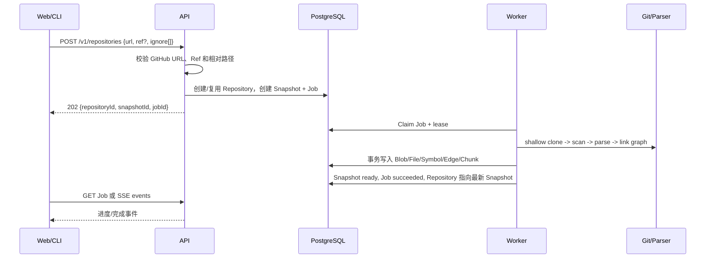
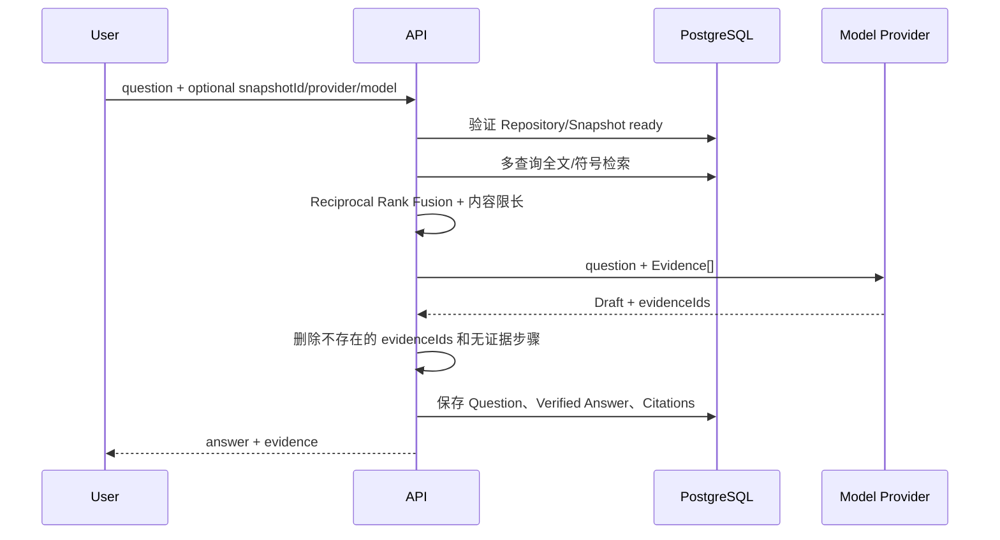

# 领域模型与数据流

状态：v0.1 已实现基线

## 1. 核心对象

| 对象 | 含义 | 关键不变量 |
|---|---|---|
| Repository | 公共 GitHub 仓库身份 | 在公共 Workspace 中按 canonical URL 唯一 |
| Snapshot | 一次不可变索引请求 | Ready 后必须绑定 Commit SHA 和 Parser Version |
| Analysis Job | Snapshot 的异步执行记录 | 只有持有有效租约的 Worker 可以完成 |
| Snapshot File | Snapshot 中的文本文件 | `(snapshot_id, path)` 唯一，路径不能逃逸 |
| Symbol | Parser 提取的模块或声明 | `(snapshot_id, stable_key)` 唯一并带行号 |
| Symbol Edge | contains/imports/calls 等关系 | 必须有已解析目标或未解析文本目标之一 |
| Code Chunk | 可检索证据块 | 带 Snapshot、文件、可选 Symbol 和内容哈希 |
| Message/Citation | 问题、答案和可信引用 | Citation 必须来自同一 Snapshot 的 Evidence |
| Share Report | 公开阅读导览 | 固定 Repository、Snapshot 与生成内容版本 |

数据库保留 `users/workspaces/workspace_members` 作为未来演进边界，但 v0.1 运行时只使用初始化 Migration 创建的 Public Demo 用户和 Public Workspace，没有登录流程。

## 2. 导入与索引



相同仓库可以多次导入并产生多个 Snapshot。每个已完成结果保留原 Commit，因此仓库继续更新也不会让旧引用漂移。

## 3. Snapshot 状态

```text
requested
  -> cloning
  -> scanning
  -> parsing
  -> building_graph
  -> ready

任意活动阶段 -> failed
任意活动阶段 -> cancelled
```

Contract 还保留 `embedding` 状态，但当前 Worker 不进入该阶段。Job 状态与 Snapshot 状态分开：Job 使用 `queued/running/succeeded/failed/cancelled`，Snapshot 记录更细的分析阶段。

## 4. 租约与恢复

1. Worker 原子领取 `queued` 或租约过期的 `running` Job。
2. `lease_owner` 为当前 `WORKER_ID`，到期时间由 `JOB_LEASE_SECONDS` 控制。
3. Worker 后台续租，并在 Clone、扫描、每个解析 Batch、建图和持久化前检查。
4. Worker 崩溃后，租约过期，另一个 Worker 可以接管。
5. 旧 Worker 失去租约后不能完成任务。
6. API 的 Cancel 只设置取消请求；Worker 在 Checkpoint 转换为 cancelled。

## 5. 地图与源码读取

API 从 File、Symbol 和 Edge 数据构建三种视图：

- `package`：按首级目录聚合文件关系。
- `file`：展示解析出的本地文件依赖。
- `symbol`：展示声明与 contains/imports/calls 关系。

地图节点携带 `path` 和可选 `startLine/endLine`。Web 点击节点后调用 Source API，并且 Source 返回 Snapshot Commit、Blob Hash 和实际行片段。

## 6. 可信问答



模型不决定 Citation 的路径、行号和 Quote。服务端根据合法 Evidence ID 重新生成这些字段；没有合法引用时答案会降级为 `refused`。

## 7. 分享报告

创建 Share Report 时，API 读取 Ready Snapshot，生成包级地图和最多八个阅读入口，并保存为 JSON。Slug 公开可读且固定到该 Snapshot。v0.1 只处理公共仓库，因此没有“私有仓库禁止分享”的权限分支。

## 8. ID 与时间

- 业务 ID 使用数据库层生成的 UUIDv7 兼容值。
- Job Event 使用单调递增 `bigserial`，支持 `after`/`Last-Event-ID` 恢复。
- 时间统一为 PostgreSQL `timestamptz`，HTTP 输出 ISO 8601 UTC 字符串。
- 外部 API 使用 camelCase；数据库使用 snake_case。
