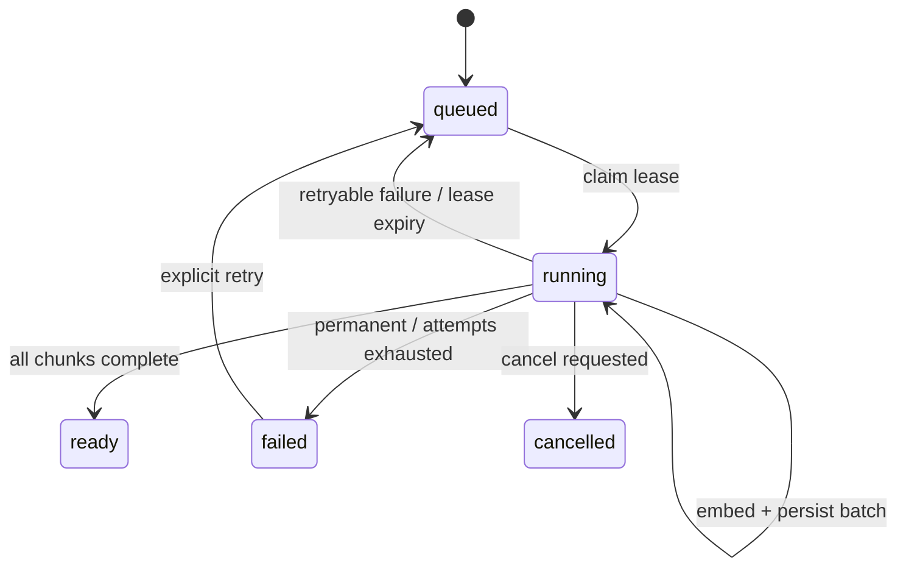

# v0.4 后端开发文档

状态：已实现并验收（2026-08-20）

## 1. 模块职责

| 模块 | 职责 | 禁止事项 |
|---|---|---|
| `packages/contracts` | Embedding Index、Retrieval Trace、Search Hit、Story v1/v2 Zod Schema | 网络和数据库访问 |
| `packages/embeddings` | Ollama/OpenAI-compatible 协议、输入构造、Vector 校验 | 持久化、选择 Snapshot |
| `packages/retrieval` | Query token、Channel Candidate、RRF、稳定排序 | 调用模型或 SQL |
| `packages/story` | 从固定 Graph Data 生成 Story v2 | 自由生成源码事实 |
| `packages/database` | Index/Job 事务、Chunk Batch、Vector、Channel Query、Story JSON | Provider HTTP |
| `apps/worker` | 租约化 Embedding Batch Loop、Heartbeat、取消、恢复 | 同时加载所有 Vector |
| `apps/api` | 配置匹配、Provider Factory、Search Orchestration、HTTP Contract | 后台长任务和 Shell |
| `apps/cli` | Embed/Search 命令和 Job 等待 | 绕过 API 直连数据库 |

## 2. 配置

新增配置：

```text
EMBEDDING_PROVIDER=none|ollama|openai-compatible
EMBEDDING_MODEL=
EMBEDDING_BATCH_SIZE=16
EMBEDDING_INPUT_MAX_CHARS=12000
EMBEDDING_REQUEST_TIMEOUT_MS=60000
```

- `none` 是默认值；没有真实 Provider 时 Semantic 不可用。
- `ollama` 默认模型可以是 `nomic-embed-text`，但只有用户显式配置后才启用。
- `openai-compatible` 复用 `OPENAI_COMPATIBLE_BASE_URL/API_KEY`，但调用 `/embeddings`。
- API 和 Worker 必须拥有相同 Provider/Model；Store Job 同时保存二者，避免进程配置漂移。

## 3. Embedding Adapter Contract

```ts
interface EmbeddingProvider {
  id: "ollama" | "openai-compatible";
  model: string;
  embed(input: readonly string[]): Promise<{
    vectors: number[][];
    model: string;
  }>;
  healthCheck(): Promise<boolean>;
}
```

Adapter 必须：

1. 使用 `AbortSignal.timeout` 或等价 Controller 限制请求时间。
2. 把空数组直接返回空 Vector，不发网络请求。
3. 验证响应条数和输入条数相同；OpenAI 响应按 `index` 排序，拒绝重复或缺失 Index。
4. 验证每个分量为 finite number，所有 Vector 维度一致且非零范数。
5. 把 401/403、模型不存在和协议错误标记为不可重试；429、5xx、Timeout、Connection Error
   标记为可重试。
6. 对外错误只保留稳定 Code、简短 Message 和 Retryable，不回显 Key 或完整上游 Body。

输入构造版本 `code-chunk-v1`：

```text
PATH: <repository-relative path>
SYMBOL: <symbol or none>
LINES: <start>-<end>
CONTENT:
<bounded source text>
```

Path、Symbol 和 Content 都是数据。最大字符数先预留固定 Header，再截断 Content；Hash 计算覆盖
最终输入，便于崩溃恢复时校验。

## 4. Embedding Worker 状态机



执行步骤：

1. `claimEmbeddingIndexJob` 用 `FOR UPDATE SKIP LOCKED` 领取最早可用 Job。
2. 校验 Job Provider/Model 等于当前 Worker 配置；不匹配时永久失败。
3. 查询 Index 的 `dimensions` 和下一批缺少匹配 Vector 的 Chunk。排序使用 `code_chunks.id`。
4. 构造 Input，调用 Provider，校验 Vector。
5. `saveEmbeddingBatch` 在一个事务内：
   - 验证 Lease Owner；
   - 首批设置 Dimensions，后续验证；
   - `INSERT ... ON CONFLICT` 仅允许相同 Content/Input Hash；
   - 更新 Embedded Count、Job Progress 和 Event。
6. 每批前后 Heartbeat 和 Cancellation Check。
7. 没有剩余 Chunk 时，在一个事务中重新 Count 并标记 Index Ready、Job Succeeded。

已持久化的正确 Batch 在崩溃后复用。若 Chunk Hash 不匹配，Index 失败而不是静默重用。

## 5. Retrieval Orchestrator

API 层实现一个可注入的 `retrieveEvidence`：

1. 验证 Ready Snapshot 和 Query。
2. 根据 Mode 决定通道：
   - Text：`searchTextEvidence`；
   - Symbol：`searchSymbolEvidence`；
   - Semantic：选择当前配置的 Ready Index，生成一个 Query Vector，调用
     `searchSemanticEvidence`；
   - Hybrid：并行执行 Text/Symbol，并在 Index 可查询时执行 Semantic。
3. 每个通道最多取 `min(200, max(20, limit * 4))` 个候选。
4. 为候选标记 Channel、1-based Rank 和 Raw Score，再调用 RRF。
5. 使用 `(fusionScore DESC, bestRank ASC, path ASC, startLine ASC, id ASC)` 稳定排序。
6. 返回 `SearchResult` 和 `RetrievalTrace`；Ask 再对结果执行现有 Content Compact 和 Token Budget。

Hybrid 中 Semantic Query 失败：

- 429/5xx/Timeout：返回 Text+Symbol，`degraded=true`、`reason=provider_unavailable`。
- Index 不存在：返回 Text+Symbol，`reason=index_not_ready`。
- Profile/Dimension mismatch：返回 Text+Symbol，但记录不可重试配置错误。
- Semantic-only 对上述情况返回 `409` 或 `503`，绝不降级成 Text。

## 6. Channel SQL 规则

### Text

- Snapshot 和 Ready 状态先过滤。
- Full-text 使用 Query Token 的 OR 组合，降低自然语言问题中通用词导致零结果的概率。
- Raw Score 由 `ts_rank_cd` 与 Path Trigram 取最大值；Path/Line/ID 稳定排序。

### Symbol

- 只返回关联 Symbol 的 Code Chunk。
- Score 优先 Exact Name、Prefix、Qualified Name，再使用 Trigram Similarity 和 Path。
- Symbol name、qualified name、path 全部参数化，不拼 SQL。

### Semantic

- Query 必须先选定 Ready `embedding_index_id`。
- 使用 Cosine Similarity `1 - (embedding <=> queryVector)`；查询 Vector 通过参数传入并 cast。
- SQL 同时校验 `embedding_index_id`、Snapshot、Dimension 和 Content Hash。
- v0.4 不把 Cosine Score 与 Text Score直接相加，只交给 RRF。

## 7. API 行为

### Retrieval status

`GET /v1/snapshots/{snapshotId}/retrieval` 返回：

- Text/Symbol 是否 Ready；
- 当前 Provider 是否配置；
- 与当前 Provider/Model 匹配的 Index 或最新历史 Index；
- Index status、dimensions、counts、Job ID、failure、queryable；
- 明确 `provider_disabled | index_missing | index_building | model_mismatch | ready` 原因。

### Create embeddings

`POST /v1/snapshots/{snapshotId}/embeddings`：

- Provider 未配置：`EMBEDDING_PROVIDER_DISABLED`；
- Snapshot 非 Ready：`SNAPSHOT_NOT_READY`；
- Ready/Running/Queued Index：幂等返回，Ready 用 `200`，新 Job 用 `202`；
- Failed Index：重置为 Queued，保留验证通过的 Partial Rows。

### Search

响应不再只回显 Mode：

```json
{
  "query": "where is response compression configured",
  "trace": {
    "requestedMode": "hybrid",
    "usedChannels": ["text", "symbol", "semantic"],
    "degraded": false,
    "channels": [],
    "embeddingIndex": {}
  },
  "results": []
}
```

### Ask

Ask Response 增加同一 `trace`。数据库继续存 Answer 与 Citation；Message 的 Prompt Version 升为
`grounded-hybrid-v2`。Provider 验证逻辑不因 Semantic 增加而放宽。

## 8. Story Builder

Story Builder 输入为 `SnapshotGraphData`，输出 `ArchitectureStoryV2`。算法：

1. 汇总 Snapshot 指标和按数量排序的语言。
2. Package Map 使用现有 `buildGraphView` 结果。
3. Key Module Score：`0.5 * importance + 0.25 * normalizedInDegree + 0.15 * normalizedOutDegree +
   0.1 * entryHint`，稳定按 Path/ID 排序。
4. Reading Path 从 README/Manifest/Entry File/Key Module Representative File 取最多 8 项并去重。
5. Evidence Highlight 优先 Entry Symbol、High Importance Symbol 和跨模块连接 Symbol；Quote 上限
   1,200 字符并带 Hash。
6. Narrative 只把上述事实填入固定模板，不能推断运行时行为。

旧 v1 Content 由 Contract Union 读取，前端按 `version` 分支渲染。

## 9. 错误码

至少新增：

- `EMBEDDING_PROVIDER_DISABLED`
- `EMBEDDING_MODEL_REQUIRED`
- `EMBEDDING_INDEX_NOT_FOUND`
- `EMBEDDING_INDEX_NOT_READY`
- `EMBEDDING_PROVIDER_MISMATCH`
- `EMBEDDING_UPSTREAM_UNAVAILABLE`
- `EMBEDDING_OUTPUT_INVALID`
- `EMBEDDING_DIMENSION_MISMATCH`
- `EMBEDDING_INPUT_STALE`
- `RETRIEVAL_MODE_UNAVAILABLE`

所有错误都沿现有 DomainError → ApiFailure 映射并带 Request ID。
