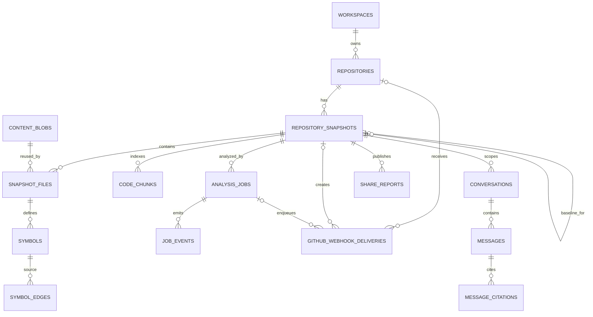

# 数据库设计

状态：v0.2 已实现并通过真实 PostgreSQL 验收（2026-08-20）
事实来源：`packages/database/migrations/0001_initial.sql`、
`packages/database/migrations/0002_incremental_github.sql`

## 1. 选择

RepoVista 使用 PostgreSQL 17 作为唯一持久化和任务协调依赖。初始 Migration 启用：

- `vector`：保留 `vector(1536)` Embedding 列，当前 Worker 尚未生成 Embedding。
- `pg_trgm`：路径和符号模糊搜索索引。
- `citext`：Email 和 Workspace Slug 的大小写不敏感约束。

全文检索使用生成的 `tsvector` 和 GIN。图使用关系表邻接模型，不需要图数据库。任务队列使用
普通表、Partial Index、行锁和租约，不需要 Redis。

Migration Runner 先保证 `schema_migrations` 存在，再按文件名顺序在事务中执行未记录的 SQL。
已发布 Migration 不允许原地修改；结构演进必须新增前向文件。

## 2. 表分组

### Migration 与公共边界

| 表 | 用途 |
|---|---|
| `schema_migrations` | 已应用 SQL 文件和时间 |
| `users` | 未来身份边界；当前只 Seed Public Demo User |
| `workspaces` | 未来租户边界；当前只用 Public Workspace |
| `workspace_members` | 未来角色边界；当前没有认证/API 权限逻辑 |

### 仓库与不可变 Snapshot

| 表 | 用途 |
|---|---|
| `repositories` | Canonical GitHub Identity、Ignore、自动更新元数据、最新 Ready Snapshot |
| `repository_snapshots` | Commit、Ref、状态、Parser/Index Version、基线、模式、Tree Hash、统计 |
| `content_blobs` | SHA-256 内容寻址的内联文本 |
| `snapshot_files` | Snapshot Path 到 Blob 的映射、语言、大小、行数和 Parse Status |

### 静态分析与检索

| 表 | 用途 |
|---|---|
| `symbols` | Module/Declaration、Stable Key、Signature、Source Range |
| `symbol_edges` | contains/imports/calls/extends 等已解析或未解析关系 |
| `code_chunks` | 文件/符号证据、全文向量、可选 Embedding |

### 异步任务与自动更新

| 表 | 用途 |
|---|---|
| `analysis_jobs` | Queue、Progress、Attempt、Lease、Cancel 和 Error |
| `job_events` | SSE 可恢复事件流 |
| `github_webhook_deliveries` | Delivery 幂等、Payload Hash、处理结果和资源关联 |

### 问答与分享

| 表 | 用途 |
|---|---|
| `conversations` | Repository/Snapshot 级问题容器 |
| `messages` | User/Assistant 内容、Grounding、Provider、Model 和延迟 |
| `message_citations` | 服务端验证后的文件、Symbol、行号、Quote 和 Hash |
| `share_reports` | 固定 Snapshot 的公开导览 JSON 和 Slug |

Markdown/SVG 不建表：它们从不可变 Ready Snapshot 即时、确定性生成。

## 3. 关系

Webhook Delivery 的三个业务外键都可空并使用 `ON DELETE SET NULL`，使删除业务数据后仍能保留
最小幂等审计；原始 Payload 不入库。

## 4. Repository 与 Snapshot

### Repository

- `(workspace_id, canonical_url)` 唯一。
- Provider 当前只允许 `github`。
- Visibility 字段允许 public/private 作为演进边界，但 API 只创建 public。
- `latest_ready_snapshot_id` 外键使用 `ON DELETE SET NULL`。
- `auto_update_enabled` 默认为 false。
- `github_installation_id` 可空且必须为正数；它只是来源元数据，不是 Token。
- `last_webhook_at` 记录最近一次有效且属于该仓库的 Push。

### Snapshot

- Ready Snapshot 由应用保证具备完整 40 位 Commit SHA。
- `(repository_id, commit_sha, parser_version, index_version)` 在 Commit 非空时唯一。
- `base_snapshot_id` 是同表自引用，删除基线时 `SET NULL`。
- `index_mode` 只允许 `full/incremental`，旧数据默认 Full。
- `tree_hash` 已存在于初始 Schema；v0.2 Worker 对 Ready 新快照写入确定性值。
- `stats_json.indexing` 保存 Mode、Base Snapshot/Commit 和
  scanned/changed/reused/parsed/deleted 计数。
- `(repository_id, parser_version, ready_at DESC) WHERE status='ready'` 支持兼容基线选择。

`parent_commit_sha` 表示 Git Parent；`base_snapshot_id` 表示实际解析复用来源，两者不能混用。
JSON 统计结构由共享 Zod Contract、Store 和测试约束，数据库不为每个 JSON 字段重复建列。

## 5. 文件、Symbol 与 Edge 约束

### Snapshot File

- `(snapshot_id, path)` 唯一。
- Path 不能为空、不能是绝对路径、不能以或包含 `..` 逃逸。
- Blob Hash 外键保证 Source 内容存在。
- Parse Status 区分 parsed、skipped、failed 等扫描/解析结果。

### Symbol

- `(snapshot_id, stable_key)` 唯一。
- `start_line > 0` 且 `end_line >= start_line`。
- Stable Key 由 Parser 的文件、Kind、Qualified Name、Signature/位置规则确定。

### Edge

- 必须恰好有一种目标：`to_symbol_id` 或 `unresolved_target`。
- 已解析和未解析 Edge 分别有唯一索引，避免重试重复插入。
- Confidence 限制在 0～1。
- Snapshot Stats 的 Edge 数按数据库唯一关系口径去重，必须与实际持久化集合一致。

## 6. Job 与 Delivery 约束

### Job

- Status 只允许 `queued/running/succeeded/failed/cancelled`。
- Progress 限制在 0～1。
- `idempotency_key` 唯一。
- Claim Index 只覆盖 queued/running，Lease Index 只覆盖 running。
- 完成、失败和取消终态都必须锁定 Job 并验证 Snapshot、Worker 和 Lease Owner。

### GitHub Delivery

- `delivery_id` 是长度 1～200 的主键。
- `event_name` 非空且最多 100 字符。
- `payload_sha256` 必须匹配 `sha256:<64 lowercase hex>`。
- 持久状态只允许 `enqueued/ignored`；API 可把已存在的相同请求映射为 `duplicate`。
- 同 Delivery/同 Hash 返回首次结果；同 Delivery/不同 Hash 抛出冲突。
- 有效 Push 的 Delivery、Repository Upsert、Snapshot、Job、初始 Event 和关联更新在一个事务中。

## 7. 索引

| 索引 | 目的 |
|---|---|
| Snapshot Repository + Requested At | 历史列表 |
| Snapshot Repository + Parser + Ready At partial | 增量基线 |
| File Path trigram | 文件过滤/模糊查询 |
| Symbol Name trigram | 符号检索 |
| Symbol Snapshot + Qualified Name/Kind | 图与结构过滤 |
| Chunk `search_vector` GIN | 全文证据检索 |
| Chunk Snapshot/File | 限定不可变范围和源码顺序 |
| Job Status/Priority/Created At partial | 快速 Claim |
| Job Lease Expires partial | 崩溃接管 |
| Event Job/ID | SSE 增量读取 |
| Delivery Repository/Received At partial | 仓库自动更新审计 |

查询必须先限制 Snapshot 或 Repository，再使用文本索引，不能在所有 Workspace 和历史 Snapshot
上进行无界扫描。

## 8. 内容寻址与增量复用

Scanner 对原始字节计算 `sha256:<hex>`。`content_blobs.hash` 是主键，相同内容跨 Snapshot
复用；`snapshot_files` 保留每个 Snapshot 的 Path、语言和行数。

增量索引还会从兼容基线还原 ParsedFile，但不会让新 Snapshot 引用基线 Symbol/Edge：

1. Worker 比较 Current 与 Base 的文件元数据。
2. 复用或重新生成 ParsedFile。
3. 对完整 ParsedFile Set 重新链接。
4. 完成事务插入当前 Snapshot 的完整 File/Symbol/Edge/Chunk。

因此删除基线不会破坏已经 Ready 的增量 Snapshot。`base_snapshot_id` 是 Provenance，不是运行时
依赖。

所有允许的文本当前内联在 PostgreSQL；没有 MinIO/S3。单文件默认限制 2 MiB、仓库总文本默认
限制 500 MiB，避免无界 Blob 增长。以后引入对象存储必须通过新 Migration 和 Adapter。

## 9. Code Chunk、搜索与向量字段

完成事务为每个文本文件保存 File Chunk；可解析文件另外保存 Symbol Chunks。大文件使用受限
字符窗口分块，既覆盖顶层代码、Markdown 和不支持的语法，又提供精确声明范围。

检索使用 `simple` 配置全文向量、符号和模糊匹配。`embedding vector(1536)`、
`embedding_model` 和 Snapshot 的 `embedding_model` 是扩展点；当前 Worker 不计算 Embedding，
也没有向量索引，产品不能宣传“语义向量检索已启用”。

## 10. 公共 Workspace、分享和 Citation

初始 Migration 插入固定 Public User、Public Workspace 和 Owner Membership。当前所有导入、
答案和 Share 都使用该 Workspace。

数据库没有启用 RLS，API 也没有登录身份。部署者把实例开放给不可信用户时，必须通过反向代理、
网络和限流保护匿名接口；现有 Workspace 字段不能被描述为已完成多租户隔离。

Share Slug 包含仓库名、短 Commit 和 UUID 随机尾部。Share 创建和 Answer 保存都验证 Snapshot
属于目标 Repository。Citation 指向实际 Snapshot File 和可选 Symbol，并保存行范围、Quote 与
Evidence Hash，便于审计。

## 11. 删除、保留与迁移

多数 Repository 子资源使用 `ON DELETE CASCADE`。Blob 因跨 Snapshot 复用，不随单个 File
自动删除；清理孤立 Blob 需要显式维护任务。当前 API 不提供 Repository Delete、Retention 或
Webhook Delivery 清理 Endpoint。

任何未来删除功能都必须先定义：目标 Workspace、Snapshot/Share 保留、Blob 引用、Delivery
审计、备份和可恢复策略。

当前迁移顺序：

1. `0001_initial.sql`：基础业务、任务、证据和分享 Schema。
2. `0002_incremental_github.sql`：Repository 自动更新字段、Snapshot 基线/模式和 Delivery 表。

空库应记录恰好这两条 Migration；重复运行不执行任何 SQL 文件。回滚采用前向修复 Migration，
不提供会自动丢数据的 Down Migration。
