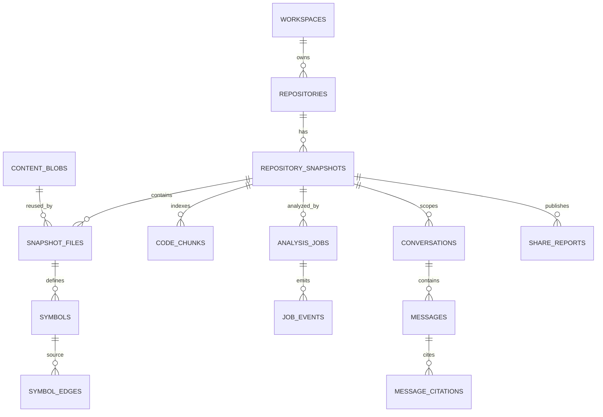

# 数据库设计

状态：v0.1 已实现基线
事实来源：`packages/database/migrations/0001_initial.sql`

## 1. 选择

RepoVista 使用 PostgreSQL 17 作为唯一持久化和任务协调依赖。初始 Migration 启用：

- `vector`：保留 `vector(1536)` Embedding 列，当前 Worker 尚未生成 Embedding。
- `pg_trgm`：路径和符号模糊搜索索引。
- `citext`：Email 和 Workspace Slug 的大小写不敏感约束。

全文检索使用生成的 `tsvector` 和 GIN。图使用邻接表，不需要图数据库。

## 2. 表分组

### Migration 与公共边界

| 表 | 用途 |
|---|---|
| `schema_migrations` | 已应用 SQL 文件 |
| `users` | 未来身份边界；v0.1 只 Seed Public Demo 用户 |
| `workspaces` | 未来租户边界；v0.1 只用 Public Workspace |
| `workspace_members` | 未来角色边界；v0.1 没有认证/API 权限逻辑 |

### 仓库与不可变 Snapshot

| 表 | 用途 |
|---|---|
| `repositories` | Canonical GitHub 身份、Clone URL、默认分支、Ignore、最新 Ready Snapshot |
| `repository_snapshots` | Commit、Ref、状态、Parser/Index Version、统计和失败信息 |
| `content_blobs` | SHA-256 内容寻址的内联文本 |
| `snapshot_files` | Snapshot Path 到 Blob 的映射、语言和扫描状态 |

### 静态分析与检索

| 表 | 用途 |
|---|---|
| `symbols` | Module/Declaration、Stable Key、Signature、Source Range |
| `symbol_edges` | contains/imports/calls 等已解析或未解析关系 |
| `code_chunks` | 文件/符号证据、全文向量、可选 Embedding；每个文本文件至少一个 File Chunk，可解析文件再有 Symbol Chunks |

### 异步任务

| 表 | 用途 |
|---|---|
| `analysis_jobs` | Queue、Progress、Attempt、Lease、Cancel 和 Error |
| `job_events` | SSE 可恢复事件流 |

### 问答与分享

| 表 | 用途 |
|---|---|
| `conversations` | Repository/Snapshot 级问题容器 |
| `messages` | User/Assistant 内容、Grounding、Provider、Model 和延迟 |
| `message_citations` | 服务端验证后的文件、Symbol、行号、Quote 和 Hash |
| `share_reports` | 固定 Snapshot 的公开导览 JSON 和 Slug |

## 3. 关系

## 4. 关键约束

### Repository

- `(workspace_id, canonical_url)` 唯一。
- Provider 当前只允许 `github`。
- Visibility 字段允许 public/private 以支持未来演进，但 API 只创建 public。
- `latest_ready_snapshot_id` 外键使用 `ON DELETE SET NULL`。

### Snapshot 与文件

- Ready Snapshot 由应用保证具备完整 40 位 Commit SHA。
- `(repository_id, commit_sha, parser_version, index_version)` 在 Commit 非空时唯一。
- `(snapshot_id, path)` 唯一。
- Path 不能为空、不能是绝对路径、不能以或包含 `..` 逃逸。
- Blob Hash 外键保证 Source 内容存在。

### Symbol 与边

- `(snapshot_id, stable_key)` 唯一。
- `start_line > 0` 且 `end_line >= start_line`。
- Edge 必须恰好有一种目标：`to_symbol_id` 或 `unresolved_target`。
- 已解析和未解析 Edge 分别有唯一索引，避免重试重复插入。
- Confidence 限制在 0～1。

### Job

- Status 只允许 queued/running/succeeded/failed/cancelled。
- Progress 限制在 0～1。
- `idempotency_key` 唯一。
- Claim Index 只覆盖 queued/running，Lease Index 只覆盖 running。

### Citation

- 每个 Message 的 Ordinal 唯一。
- Citation 指向实际 Snapshot File 和可选 Symbol。
- 行范围合法，Quote 和 Evidence Hash 持久化，便于审计。

## 5. 索引

| 索引 | 目的 |
|---|---|
| Snapshot Repository + Requested At | 历史列表 |
| File Path trigram | 文件过滤/模糊查询 |
| Symbol Name trigram | 符号检索 |
| Symbol Snapshot + Qualified Name/Kind | 图与结构过滤 |
| Chunk `search_vector` GIN | 全文证据检索 |
| Chunk Snapshot/File | 限定不可变范围和源码顺序 |
| Job Status/Priority/Created At partial | 快速 Claim |
| Job Lease Expires partial | 崩溃接管 |
| Event Job/ID | SSE 增量读取 |

查询必须先限制 Snapshot 或 Repository，再使用文本索引，不能在所有租户/历史快照上进行无界扫描。

## 6. 内容寻址

Scanner 对原始字节计算 `sha256:<hex>`。`content_blobs.hash` 是主键，相同内容跨 Snapshot 复用。`snapshot_files` 保留每次 Snapshot 的 Path、语言和行数。

v0.1 所有允许的文本内联在 PostgreSQL；没有 MinIO/S3。单文件默认限制 2 MiB、仓库总文本默认限制 500 MiB，避免无界 Blob 增长。以后引入对象存储必须通过新 Migration/Adapter，而不是把当前文档当作已实现。

## 7. Code Chunk 和向量字段

当前完成事务为文件和 Symbol 保存 Chunk，生成 `simple` 配置全文向量。检索按问题和 Token 执行全文/模糊证据查询；File Chunk 覆盖未解析文本和文件级顶层代码，Symbol Chunk 提供精确声明范围。

`embedding vector(1536)`、`embedding_model` 和 Snapshot 的 `embedding_model` 是 Schema 扩展点。当前 Worker 不计算 Embedding，也没有向量索引；产品不能宣传“语义向量检索已启用”。

Share Slug 包含仓库名、短 Commit 和 UUID 随机尾部，避免 UUIDv7 时间前缀在同一毫秒造成碰撞。Share 创建和 Answer 保存都验证 Snapshot 属于目标 Repository。

## 8. 公共 Workspace

初始 Migration插入固定 Public User、Public Workspace 和 Owner Membership。所有 v0.1 导入、答案和 Share 都使用该 Workspace。

数据库没有启用 RLS，API 也没有登录身份。部署者如果把实例开放给不可信用户，必须通过外部网络访问控制限制匿名接口。多租户/RLS 属于后续版本，不能只依靠现有 Workspace 字段声称已隔离。

## 9. 删除与保留

多数 Repository 子资源使用 `ON DELETE CASCADE`。Blob 因跨 Snapshot 复用，不随单个 File 自动删除；清理孤立 Blob 需要显式维护任务。v0.1 API 不提供 Repository/Delete 或 Retention Endpoint。

任何未来删除功能都必须先定义：目标 Workspace、Snapshot/Share 保留、Blob 引用计数、审计和可恢复策略。
