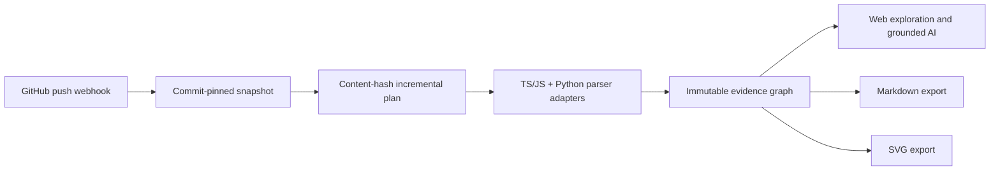

# RepoVista v0.2 开发计划

状态：已实现并验收（2026-08-20）
版本目标：把一次性的 TypeScript/JavaScript 仓库分析，升级为可持续更新、支持 Python、可验证并可导出的代码知识地图。

## 1. 发布叙事

v0.2 的四项能力属于同一条完整链路，而不是四个独立演示：

用户能够先手工导入公共 GitHub 仓库；配置了共享 Secret 的 GitHub Webhook 收到默认分支
Push 后自动创建新快照；Worker 只重解析新增或内容变化的源文件，并复用未变化文件的解析
结果；Web 明确展示本次全量或增量索引证据；任意 Ready Snapshot 都能生成固定 Commit 的
Markdown 与 SVG。

## 2. 必须交付的能力

### 2.1 增量索引

- 基线只允许选择同仓库、同 Parser Version、状态为 Ready 的最近快照。
- 以当前扫描结果的 `path + content_hash` 和基线快照比较，不依赖文件时间戳。
- 新增或变化的 TS、JS、Python 文件重新解析；内容未变化且基线解析成功的文件复用 ParsedFile。
- 删除文件不会进入新快照；所有文件重新执行跨文件 Import Linking，避免保留指向已删除模块的边。
- 每个新快照仍然是完整、不可变、可独立查询的 Snapshot，不通过运行时回溯基线拼接结果。
- `content_blobs` 按内容哈希自然去重；Snapshot-local File、Symbol、Edge、Chunk 仍独立持久化。
- Snapshot 返回 `full/incremental`、基线快照和 scanned/changed/reused/parsed/deleted 计数。

### 2.2 Python Parser Adapter

- `.py` 被 Scanner 标记为 `python`。
- Tree-sitter Python Adapter 提取 Module、Class、Function、Method 和模块级 Variable。
- 提取 `import`、`from ... import ...`、Call 和 Class Inheritance 关系。
- 支持相对模块和仓库内绝对模块到 `.py`、`/__init__.py` 的解析。
- Python 与 TS/JS 使用相同的 ParsedFile、Symbol、Edge、Evidence 和 Graph Contract。
- Parser Version 升级为组合版本；旧 v0.1 快照继续可读，但不能作为新 Parser 的增量基线。

### 2.3 GitHub Webhook 自动更新

- 新增 GitHub Webhook Endpoint，并使用原始请求体验证 `X-Hub-Signature-256` HMAC-SHA256。
- `GITHUB_WEBHOOK_SECRET` 未配置时，自动更新能力明确显示为 Disabled，Webhook 不接受事件。
- 支持 `ping` 和 `push`；其他事件可被安全、可观测地忽略。
- 只为 Public Repository、非删除 Push、默认分支 Push 创建索引任务。
- 使用 `X-GitHub-Delivery` 作为数据库唯一键，重复投递不得创建重复 Snapshot/Job。
- Webhook 只触发已有的公共 HTTPS Clone 流程，不执行 Payload 中的 URL、不运行仓库脚本，也不新增私有仓库 Token 能力。
- Web 展示服务器自动更新能力以及仓库最近一次有效 Webhook 时间。

### 2.4 Markdown 与 SVG 导出

- Ready Snapshot 可按需导出 Markdown 架构报告和 SVG 架构地图。
- 输出必须固定 Snapshot ID、完整 Commit SHA、Parser Version 和生成时间来源。
- Markdown 只使用确定性静态分析数据，不把 AI 生成文本伪装成事实。
- SVG 必须转义所有仓库控制的文本，限制节点数，并使用确定性服务端布局。
- 通过 `Content-Disposition: attachment` 提供安全文件名；不在 v0.2 引入对象存储或导出任务表。
- Web Repository Workspace 提供明确的 Download Markdown / Download SVG 操作。

## 3. 成功标准

v0.2 只有同时满足以下条件才可标记完成：

1. 两次索引同一仓库不同 Commit，第二次能证明只解析变化的受支持文件，并得到完整可查询的新快照。
2. 一个真实公共 Python 仓库能够完成 Clone、Scan、Parse、Graph、Source、Search、Ask 和 Export。
3. 有效签名的默认分支 Push 创建一个 Job；错误签名被拒绝；同 Delivery 重放不会重复入队。
4. Markdown 与 SVG 在 API、Web 和真实 Compose 中均可下载，内容绑定正确 Commit，SVG 可被 XML Parser/浏览器读取。
5. v0.1 的 TS/JS、可信问答、Share、CLI 和固定 Snapshot 导航没有回归。
6. OpenAPI、Lint、Typecheck、Unit/Integration、Build、Playwright、Docker Compose 和真实数据库验收全部通过。

## 4. 明确不包含

- 私有仓库 Clone、GitHub Installation Token、OAuth 登录和 GitHub API 回调。
- Pull Request 影响分析、Go Parser、VS Code Extension。
- 增量扫描 Git Worktree；v0.2 仍扫描当前 Commit 的安全文本文件，再复用解析结果。
- 跨 Snapshot 查询时的运行时 Overlay；每个 Ready Snapshot 必须自包含。
- 导出历史、对象存储、PDF/PNG/Mermaid 导出。
- 自动修改仓库、创建 Commit、Issue、PR 或评论。

## 5. 交付顺序与提交边界

1. 文档、ADR 与 Contract 计划。
2. 数据库 Migration、Snapshot 增量元数据和增量 Planner。
3. Python Adapter 与跨语言 Import Linking。
4. GitHub Webhook 验签、幂等入队和自动更新状态。
5. Exporter Package、API 和 Web 交互。
6. 回归修复、公开仓库验收、Compose/Browser 审计和发布文档。

每个边界都必须单独以 `yueliang <yueliang@users.noreply.github.com>` 提交；不把生成物或其他项目资源混入本仓库。

## 6. 实现结果

- 增量索引：同 Repository、同 Parser Version 的最近 Ready Snapshot 作为基线；新快照自包含。
- Parser：组合版本 `tree-sitter-ts-js-py-v1`，支持 TypeScript、JavaScript、Python。
- 自动更新：原始 Body HMAC 验签、Public/default-branch 筛选、Delivery 原子幂等与冲突检测。
- 导出：确定性 Markdown/SVG、固定 Snapshot/Commit/Parser Provenance、SVG XML/CSP 安全边界。
- Web：Delta、Automation、Python Source、SSE Message、固定 Snapshot 下载与浏览器回归。

发布验收证据与真实仓库 SHA 记录在
[v0.2 测试与发布计划](../operations/v0.2测试与发布计划.md) 的第 8 节。
