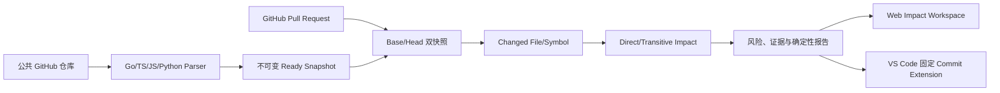

# RepoVista v0.3 开发计划

状态：开发中（文档冻结）  
版本目标：把 RepoVista 从“固定快照代码地图”升级为“可解释的 Pull Request 影响工作台”，并让 Web 与 VS Code 共享同一套 Commit 固定证据。

## 1. 一条完整链路

v0.3 的三个 Roadmap 项必须共享同一个数据链路：Go 解析结果进入现有 Graph Contract；PR 分析只消费两个不可变快照；Web 和扩展只消费 PR Analysis API 返回的证据，不自行解析或猜测影响。

## 2. 必须交付的能力

### 2.1 Go Parser Adapter

- 扫描器识别 `.go` 为 `go`，Parser Version 升级为 `tree-sitter-ts-js-py-go-v1`。
- 使用 Tree-sitter Go 提取 Module、Function、Method、Struct（映射 `class`）、Interface、Type 和包级 Variable/Const（映射 `variable`）。
- 提取 `import`、函数/方法 Call、Struct Embedding（`extends`）、Interface 实现（`implements`）和声明包含关系；每条边携带源码行号、语法类型、目标文本与置信度。
- Go receiver 方法的限定名为 `Type.Method`；函数签名至少包含参数文本，稳定键不包含易变行号。
- 本地 Import Linking 支持 `go.mod` 的 module path：先读取 module 声明，再将 `example.com/app/pkg/x` 映射到仓库相对目录；同包导入、`./` 和标准库/第三方导入保留为 unresolved。
- `parseRepository`、增量 Planner、Snapshot stats 和数据库 parse status 必须把 Go 纳入同一条路径。
- v0.2 的旧快照保持可读；旧 Parser Version 快照不能作为 v0.3 新索引的增量基线。

### 2.2 Pull Request Impact Analysis

- 仅支持公共 GitHub Pull Request 元数据；默认通过 GitHub REST API 读取 PR 的 `base.sha`、`head.sha`、标题、编号、URL 和变更文件。可选只读 Token 仅用于限流提升，不改变私有仓库范围。
- Base 与 Head 必须是同一 Repository、不同或相同的完整 Commit SHA；各自通过现有安全 Clone/Index 流程生成或复用 Ready Snapshot。
- PR Analysis 是不可变记录：创建后不能改变 base/head/parser version；重新运行产生新的 analysis revision，不覆盖旧结果。
- Changed File：按路径集合与 blob/content hash 比较，分类 `added/modified/deleted/renamed/unchanged`。Changed Symbol：按稳定键、内容哈希和范围比较，分类 `added/modified/deleted/moved`。
- Direct Impact：Head 中从 changed symbol 出发沿 `calls/imports/extends/implements/reads/writes` 的反向邻接边取一跳；Deleted symbol 使用 Base 图的反向边。Transitive Impact：在同一关系集合上 BFS，最多 5 跳、最多 2,000 个节点，记录最短距离和路径边。
- 风险评分是确定性的：`0.45 * changedSymbolWeight + 0.30 * reverseFanInWeight + 0.15 * publicApiWeight + 0.10 * languageWeight`，截断到 `[0,1]`；等级为 `low/medium/high/critical`。评分必须在响应中拆解，不能由 AI 生成。
- 每个结果带 Evidence：snapshot id、commit SHA、path、line range、symbol id、关系类型、最短影响路径和算法版本。找不到静态关系时明确标记 `unknown`，不得伪造影响。
- PR 分析任务幂等键为 `repositoryId:prNumber:baseSha:headSha:parserVersion`；同键返回既有分析，Delivery/网络重试不得重复写入。
- v0.3 非目标：自动评论 PR、修改代码、创建 Commit、私有仓库授权、运行测试或执行仓库脚本。

### 2.3 VS Code Extension

- 扩展只访问配置的 API Origin，默认 `http://localhost:4000`；不上传工作区源码，不执行仓库脚本。
- Repository Mapping 由用户选择 RepoVista repository，并明确绑定本地工作区相对路径；所有导航 URL 同时携带 `snapshotId` 与完整 `commitSha`。
- 提供命令：选择仓库/快照、打开符号证据、显示 PR Impact、刷新分析、复制固定证据链接。
- Webview 使用严格 CSP，消息采用显式 schema；外部链接只允许 `https://github.com/` 与配置 API Origin。文件跳转只允许仓库相对路径和正整数行号。
- 当本地 HEAD 与绑定 Commit 不一致时显示只读警告；扩展不尝试 checkout、写文件或执行 Git 命令。
- 支持离线缓存最近一次 API 响应，但缓存键必须含 repository、snapshot、commit；过期或不匹配时拒绝导航。

## 3. API 契约增量

新增操作（全部使用现有 `{ data, meta }` 成功信封和 `ApiFailure` 错误信封）：

| Method | Path | 用途 |
|---|---|---|
| `POST` | `/v1/repositories/{repositoryId}/pull-requests` | 创建或复用 PR 分析任务 |
| `GET` | `/v1/pull-request-analyses/{analysisId}` | 获取状态、双快照和统计 |
| `GET` | `/v1/pull-request-analyses/{analysisId}/impact` | 获取分页影响节点、风险分解和证据 |
| `GET` | `/v1/pull-request-analyses/{analysisId}/events` | SSE 任务进度 |
| `POST` | `/v1/pull-request-analyses/{analysisId}/rerun` | 创建新 revision（幂等保护） |
| `GET` | `/v1/snapshots/{snapshotId}/symbols/{symbolId}` | 编辑器/影响详情的固定符号证据 |

请求必须限制编号、分页、跳数、节点数和 URL 长度；所有 repository/snapshot/analysis 归属关系在服务端验证。

## 4. 交付顺序与提交边界

1. 本文档、ADR、前后端/数据库/扩展/测试文档。
2. Contract、Go Parser、Git module scanner、Graph linking 和回归测试。
3. Migration、PR Domain/Store、GitHub client、Worker 分析任务和 API。
4. Web Impact Workspace、固定证据与错误/加载状态。
5. VS Code Extension、打包、宿主测试和 API mock 验收。
6. 真实数据库、公共仓库、PR fixture、浏览器、扩展、Compose 和发布审计。

每个边界单独以 `yueliang <yueliang@users.noreply.github.com>` 提交；不 Push、不配置 Remote、不混入其他项目。

## 5. 完成标准

1. 一个真实 Go 公共仓库完成 Clone、Scan、Parse、Import Linking、Graph、Source、Search 和增量索引。
2. 一个脱敏 GitHub PR fixture 能生成 base/head 快照、changed symbols、direct/transitive impact、风险和逐条证据；重复请求不会产生重复分析。
3. Web 能显示双快照、文件/符号变化、影响路径、风险解释和固定源码跳转；分析失败、限流和缺失关系有明确状态。
4. VS Code Extension 能在 mock API 与真实本地 API 下选择仓库、打开固定源码行、显示影响证据，并拒绝错误 Commit/路径。
5. v0.2 的 20 个 OpenAPI operations、TS/JS/Python、Webhook、导出、AI 引用验证、CLI、Playwright 和 Compose 全部无回归。
6. OpenAPI、Lint、Typecheck、Unit/Integration、PostgreSQL、Worker、API、Web、Extension host、容器构建和发布验收全部通过。
