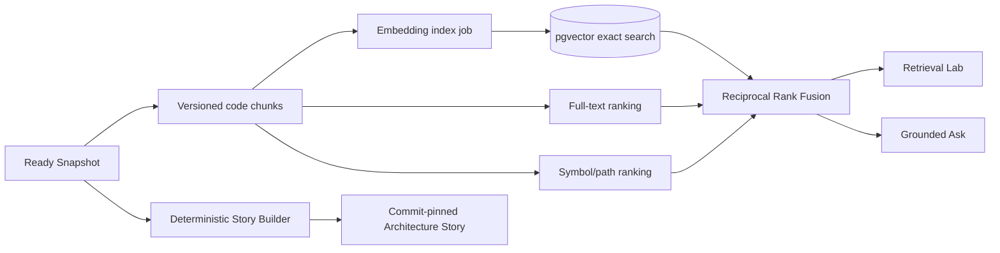

# RepoVista v0.4 开发计划

状态：已实现并验收（2026-08-20）
版本主题：透明混合语义检索与 Architecture Story  
目标版本：`0.4.0`

## 1. 版本结论

v0.4 不把 RepoVista 变成另一个无法解释的“仓库聊天框”。本版本在 v0.3 的不可变
Snapshot、源码证据和静态图之上增加一条可核验的真实 Embedding 路径，并把全文、符号和
语义通道的排名过程公开给用户。

同一份固定 Commit 数据还会生成更适合传播的 Architecture Story：它展示仓库规模、主要
语言、核心模块、入口热点、阅读路线、架构图、代表性源码证据和完整生成来源。Story 的事实
由确定性图算法产生，不依赖模型想象；AI 仍只是可选解释层。

## 2. 一条完整用户链路

1. 用户导入公共 GitHub 仓库，得到一个 Ready、Commit 固定的 Snapshot。
2. 全文和符号检索立即可用；页面明确显示语义索引是否已配置、正在构建或不可用。
3. 配置 `ollama` 或 `openai-compatible` Embedding Provider 后，用户可为这个 Snapshot
   创建一个版本化 Embedding Index。
4. Worker 分批读取现有 Code Chunk，构造受限输入，调用真实 Embedding API，校验维度与数值，
   再把 Vector 写入 PostgreSQL。
5. Retrieval Lab 支持 `text | symbol | semantic | hybrid`。每条结果显示参与通道、原始排名、
   RRF 分数、固定 Commit、路径、行号和源码。
6. `Ask repository` 使用同一 Retrieval Pipeline，并返回本次检索 Trace；模型引用仍必须经过
   Evidence ID 校验。
7. 用户生成 Architecture Story。公开页固定到同一 Snapshot，并公开 Parser、Commit、Story
   版本以及可选 Embedding Profile 来源。

## 3. 必须交付的能力

### 3.1 真实、可替换的 Embedding Provider

- 新增独立 `packages/embeddings`，支持：
  - Ollama `POST /api/embed`；
  - OpenAI-compatible `POST /embeddings`；
  - 仅测试使用的内存确定性 Provider，不允许在生产配置中伪装成语义模型。
- Chat Provider 与 Embedding Provider 使用独立配置。`MODEL_PROVIDER=fake` 不代表存在
  Semantic Search。
- Provider 返回的 Vector 必须是非空、有限数值、统一维度且维度不超过 PostgreSQL pgvector
  安全上限；零向量、NaN、Infinity、条数不符和维度漂移全部失败。
- Code Chunk 输入包含路径、符号名和截断源码；截断策略、最大字符数和 Input Version 必须
  持久化，避免同名模型在不同输入策略下混用。
- 批大小、请求超时、最大输入和重试由配置限制；任何 Repository 文本都只能作为 API data，
  不能改变请求目标、Header 或模型名称。

### 3.2 Snapshot Embedding Index Job

- Embedding 不改变 Ready Snapshot 的源码、图或 Commit；它是挂在 Snapshot 下的派生索引。
- 同一 `(snapshot, provider, model, inputVersion)` 只存在一个 Index。重复请求返回既有 Ready/
  Running Job；失败重试复用已验证的 Chunk Vector，不重复覆盖完整结果。
- Worker 通过现有 PostgreSQL Lease 领取 `embed_snapshot` Job，按稳定 Chunk 顺序分批处理，
  定期 Heartbeat，并支持取消、租约丢失、崩溃恢复和进度事件。
- 首批 Vector 决定维度，后续批次必须完全一致。只有全部 Snapshot Chunk 都拥有匹配
  `content_hash` 的 Vector，Index 才能进入 Ready。
- Provider 未配置、模型不匹配或 API 无法使用时，全文、符号、地图、源码、导出、Story 和
  Fake Ask 仍可工作。

### 3.3 透明检索与可信 Ask

- `text`：只使用 PostgreSQL Full-text 与 Path 信号。
- `symbol`：只使用 Symbol name、qualified name 与 Path 的精确/模糊信号。
- `semantic`：必须使用当前配置对应的 Ready Embedding Index；不存在时返回稳定错误，不伪装
  成语义结果。
- `hybrid`：对可用的 Text、Symbol、Semantic 候选做确定性 Reciprocal Rank Fusion；若语义
  通道不可用，继续返回 lexical 结果，但 `degraded=true` 并解释原因。
- Search Response 必须包含 Requested Mode、实际使用通道、每个通道状态、候选数、Profile
  来源和每条 Hit 的 Channel Rank/Score。
- 所有排序具有稳定 Tie-breaker；相同输入、Snapshot、Profile 和代码版本必须得到相同顺序。
- Ask 复用 Hybrid Retriever，不再维护一条不透明的私有检索路径；返回 Retrieval Trace 并将
  最终 Fusion Score 用于 Citation 持久化。

### 3.4 Evidence Retrieval Lab

- Repository Workspace 新增 `Search evidence` 主标签，而不是把搜索藏在 Ask 内。
- 支持四种 Mode、Query History、键盘提交、空状态、加载、取消旧请求、失败重试和结果数量。
- 每条结果显示 Snapshot/Commit、Path、Symbol、Line Range、源码摘要、Fusion Score，以及
  Text/Symbol/Semantic 各自的 Rank 和 Raw Score。
- Semantic Index 状态卡显示 Provider、Model、Dimensions、Embedded/Total Chunks、Job 进度、
 失败原因和“Build/Retry index”操作；没有配置时给出本地 Ollama 示例，而不是显示假 Ready。
- 点击结果使用现有不可变 Source Drawer；所有行号和路径仍由 API Evidence 决定。

### 3.5 Architecture Story v2

- 新增纯函数 `packages/story`，只消费 Snapshot Graph Data，输出版本化 Story Contract。
- Story 至少包含：
  - 仓库/Commit Hero 与 Files/Symbols/Edges/Languages 指标；
  - Package Architecture Map；
  - 根据图 Importance、入度/出度与入口命名规则选出的 Key Modules；
  - 基于固定 File/Symbol 的“Start here”阅读路线；
  - 代表性 Evidence Highlights，带 Path、Line Range、Quote 和 Hash；
  - Provenance：Snapshot、Parser、Story Algorithm、生成时间来源和可选 Retrieval Profile。
- 所有描述必须能由持久化数据重建；不得把模型生成文本当作静态分析事实。
- v1 `architecture_tour` 分享记录继续可读；新记录写 `content_version=2` 和
  `report_type='architecture_story'`。
- 公共 Story 页面需要适合截图与分享，但不要求登录、模型 Key 或浏览者访问原 Provider。

### 3.6 CLI 与可复现评估

- CLI 新增 `search <snapshot-id> <query>`，支持 `--mode`、`--limit` 和 `--json`。
- CLI 新增 `embed <snapshot-id>`，支持 `--wait`，复用通用 Job 状态输出。
- Benchmark 增加固定小型 Corpus 的 Text/Symbol/Semantic/Hybrid Recall@K 与 MRR 计算；模型
  相关结果必须记录 Provider、Model、Dimensions、Commit、机器和命令。
- README 只声明真实验收过的 Provider/Model 和指标，不用 Mock 数字做宣传。

## 4. API 增量

新增或升级以下 Operation：

| Method | Path | 用途 |
|---|---|---|
| `GET` | `/v1/snapshots/{snapshotId}/retrieval` | 获取 Text/Symbol/Semantic 能力与当前 Index 状态 |
| `POST` | `/v1/snapshots/{snapshotId}/embeddings` | 创建、复用或重试当前配置的 Embedding Index Job |
| `GET` | `/v1/snapshots/{snapshotId}/search` | 真实执行四种 Mode 并返回 Trace 与 Search Hit |
| `POST` | `/v1/repositories/{repositoryId}/ask` | 复用 Hybrid Retriever，响应增加 Retrieval Trace |
| `POST` | `/v1/share-reports` | 默认生成 Architecture Story v2 |
| `GET` | `/v1/share-reports/{slug}` | 同时读取 v1 Tour 与 v2 Story |

继续使用现有 `{ data, meta }` / `ApiFailure` 信封、Request ID、Zod、OpenAPI 和 Rate Limit。

## 5. 明确非目标

- 不支持私有仓库、OAuth、GitHub App Installation Token 或多租户权限 UI。
- 不让模型决定静态调用关系、PR Impact、Story Hotspot 或源码事实。
- 不自动下载模型，不在容器内捆绑大模型权重；用户显式运行 Ollama 或配置兼容 Endpoint。
- 不引入独立 Vector Database、Redis、Kafka、对象存储或后台微服务。
- 不对混合维度建立虚假的全局 ANN Index；v0.4 在单 Snapshot 范围执行有界 Exact pgvector
  查询，并用真实基准决定未来是否分维度增加 HNSW。
- 不执行被分析仓库的代码、测试、构建脚本或 Agent 修改。

## 6. 性能与安全预算

- Search `limit <= 100`；每通道 Candidate Pool `<= 200`；Query `<= 4,000` 字符。
- Embedding Batch `1..64`；单 Chunk Embedding Input 默认 `<= 12,000` 字符；Vector Dimension
  `1..16,000`。
- Embedding Job 必须流式分批读取，不能把大型仓库全部 Vector 同时保存在内存。
- Exact Semantic Query 先限定 `embedding_index_id`，再排序并限制候选；执行计划和真实耗时写入
  验收记录。
- Provider Error 对外使用稳定 Error Code，不返回 API Key、完整 Endpoint 凭据或原始响应体。
- Story Quote 有长度上限并进行普通文本渲染；不得使用不可信 HTML。

## 7. 提交边界

1. 本开发计划、ADR、前端、后端、数据库与测试发布文档。
2. Contract、Embedding Adapter、Retrieval Fusion、Story Builder 与纯函数测试。
3. Migration、Store、Embedding Worker、API、OpenAPI 与 PostgreSQL Integration。
4. CLI 与 Web Retrieval Lab、Story v2、组件测试和 Playwright。
5. 真实 Ollama/Public Repository 验收、性能记录、README/Roadmap/Changelog、完整发布门禁。

每个边界使用 `yueliang <yueliang@users.noreply.github.com>` 提交；主仓库和
`extensions/vscode` 始终保持独立 Git。本版本若没有修改扩展，不创建无意义扩展提交。

## 8. 完成定义

v0.4 只有同时满足以下条件才算完成：

1. 一个真实公共仓库的 Ready Snapshot 能用本机 Ollama Embedding 模型完成全部 Chunk Index，
   数据库记录真实 Provider、Model、Dimensions 和 Chunk Counts。
2. 至少一个没有直接词面重合的自然语言 Query 能通过 Semantic/Hybrid 找到人工确认的源码，
   并记录 Text/Symbol/Semantic/Hybrid 排名差异。
3. Provider 停止、未配置、维度异常、超时和中途重启均有自动化或真实验收；Hybrid 明确降级，
   Semantic-only 明确失败。
4. Ask 返回的 Evidence 与 Search Pipeline 一致，伪造 Citation 继续被移除。
5. Web Retrieval Lab 能构建 Index、观察进度、切换 Mode、查看 Score Trace 并打开固定源码。
6. 新 Architecture Story 可公开访问、固定 Commit、显示图/热点/阅读路线/Evidence/Provenance；
   旧 v1 Share fixture 不回归。
7. CLI Search/Embed、OpenAPI、Lint、Typecheck、Unit、PostgreSQL Integration、Worker、API、Web、
   Playwright、Build、Compose、容器镜像、Git fsck 和工作树审计全部通过。
