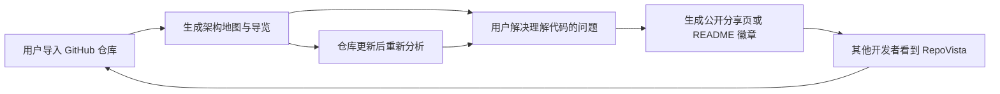
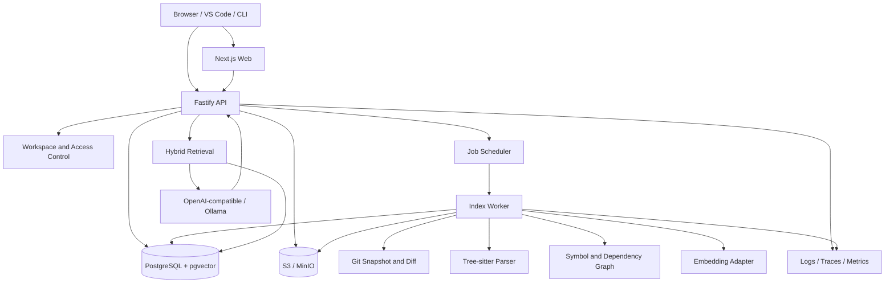

# 面向 GitHub Stars 的项目方向研究

> 创建时间：2026-08-14  
> 目标：找到一个既能真正解决问题、又能展示完整工程能力，并且具备 GitHub 传播潜力的开源项目方向。

> 文档性质：产品发现与历史设计草案。本文保留了候选方向和长期设想，其中部分能力（例如私有仓库、OAuth、对象存储和多租户权限）不属于已实现的 v0.2。当前行为以根目录 README、`docs/README.md`、`openapi/openapi.json` 和代码为准。

---

## 一、先说结论

如果目标只是练习全栈开发，个人博客是一个合格项目。

如果目标是获得 GitHub Stars、形成个人技术名片，普通个人博客并不是最优选择。博客、博客模板、CMS、静态站点生成器都已经非常拥挤。单纯增加登录、评论、分类、标签、后台管理、暗色模式，并不会让项目自然获得关注。

我最推荐做：

# RepoVista：AI 原生、Local-first 的代码仓库地图与新人上手助手

一句话介绍：

> 输入一个 GitHub 仓库地址，自动生成可交互的架构地图、模块说明、调用关系、带源码引用的 AI 问答，以及适合分享的新手导览页面。

它不是“再做一个 AI 聊天框”，而是把复杂代码仓库变成一张能浏览、能提问、能验证、能分享的地图。

这个项目比普通博客更容易获得 Stars，因为：

1. GitHub 用户本身就是目标用户，传播场景天然重合。
2. 对陌生代码库快速上手是普遍且真实的痛点。
3. 架构图、调用链、代码热区很适合制作 GIF 和短视频，视觉冲击力强。
4. AI、代码分析、AST、RAG、可视化、性能优化、数据库设计都能自然出现，而不是为了炫技硬塞进去。
5. 项目可以先小后大：第一版只分析 TypeScript 仓库，之后再扩展语言和功能。
6. 每个被分析的开源仓库，都可能生成一个公开分享页，形成自然传播。
7. 它还可以生成“项目技术故事页”，最终反过来成为你的个人博客和作品集内容来源。

最重要的一句话：

> GitHub Stars 不是“功能数量”的奖励，而是用户对清晰价值、低使用门槛、可信质量和传播意愿的综合投票。

---

## 二、不要从“完美项目”开始

“完整、完善、完美、前沿、高性能”是长期目标，不应该成为第一版的进入门槛。

一个容易失败的路径是：

1. 先设计几十张数据库表。
2. 一开始就拆成十几个微服务。
3. 同时支持 Web、桌面端、移动端和浏览器插件。
4. 同时接入十种 AI 模型。
5. 三个月后仍然没有一个陌生用户能成功使用。

一个更可能获得 Stars 的路径是：

1. 先找到一句话就能讲清楚的痛点。
2. 做出 30 秒内可以看懂的“惊艳时刻”。
3. 让用户用一条命令或一个仓库链接体验。
4. 用真实用户反馈决定第二批功能。
5. 在持续发布中逐步形成完整工程。

这里所说的“先发布”，不等于粗制滥造。第一版仍然应该做到：

- 核心路径可以使用。
- 安装说明准确。
- UI 统一且有辨识度。
- 没有明显安全问题。
- 有自动化测试。
- 有清晰的 README、截图、演示和路线图。
- 明确写出暂不支持什么。

---

## 三、什么样的项目更容易获得 GitHub Stars

可以用一个简单公式理解：

> Star 潜力 = 痛点强度 × 目标人群规模 × 首次体验速度 × 展示效果 × 可传播性 × 持续维护可信度

### 1. 痛点强度

用户是“觉得有趣”，还是“今天就想用”？

能节省时间、减少重复劳动、降低学习门槛、保护隐私、提升开发效率的项目，通常更容易被收藏。

### 2. 目标人群规模

GitHub 上最容易传播的用户群，往往就是开发者、开源维护者、技术团队和 AI 工具使用者。

因此，开发者工具通常比只服务某个小行业内部流程的项目更容易获得 Stars。

### 3. 首次体验速度

理想状态：

- 访问在线 Demo：10 秒看到结果。
- 本地运行：一条命令。
- 导入仓库：粘贴 URL。
- 不注册也能体验公共仓库。

### 4. 展示效果

一个好的开源项目，需要有可以截图、录 GIF、做视频的“视觉锤”：

- 架构地图自动展开。
- 点击节点跳转源码。
- 输入问题后，答案逐字出现并标出源码引用。
- 拖动时间轴，看仓库架构随提交演化。

### 5. 可传播性

用户使用之后，是否会自然产生一个愿意分享的结果？

例如：

- 一张仓库架构图。
- 一个公开的新手导览页面。
- 一份代码健康报告。
- 一个带项目 Logo 的分享链接。

### 6. 维护可信度

README、发布记录、Issue 回复速度、测试、文档、版本策略和路线图，都会影响别人是否愿意 Star。

---

## 四、候选项目方向评分

评分范围为 1～5。分数不是绝对真理，而是帮助做取舍。

| 方向 | 痛点 | 视觉效果 | 传播性 | 技术展示 | 单人可行性 | 综合判断 |
|---|---:|---:|---:|---:|---:|---|
| RepoVista：AI 代码仓库地图 | 5 | 5 | 5 | 5 | 3 | 最推荐，控制第一版范围 |
| GitGarden：AI 原生个人数字花园 | 3 | 5 | 4 | 4 | 4 | 最贴近博客想法，但赛道拥挤 |
| AgentReplay：AI Agent 调试与回放平台 | 5 | 4 | 4 | 5 | 3 | 很前沿，适合偏后端与 AI 工程 |
| SchemaCanvas：数据库 Schema 可视化与审查 | 4 | 5 | 4 | 4 | 4 | 边界清楚，较容易做出精品 |
| API Time Machine：API 流量录制、回放与契约漂移检测 | 5 | 3 | 4 | 5 | 3 | 工程价值高，但演示需要设计 |
| EnvDoctor：开发环境自动诊断与修复建议 | 4 | 3 | 4 | 4 | 4 | 很实用，跨平台适配工作较多 |
| Changelog Studio：从提交和 PR 生成发布故事 | 4 | 4 | 5 | 3 | 5 | 最容易快速发布，但技术深度稍弱 |
| FileFlow：本地优先的万能文件处理流水线 | 4 | 4 | 4 | 4 | 3 | 用户面广，但容易失去聚焦 |
| OSS Launch Kit：开源项目发布质量检查工具 | 4 | 3 | 5 | 3 | 5 | 能直接服务 GitHub 创作者 |
| Privacy Inbox：本地 AI 邮件与文档整理台 | 4 | 4 | 3 | 5 | 2 | 产品价值高，权限与安全复杂 |

### 推荐顺序

1. 想最大化技术展示和 Star 潜力：RepoVista。
2. 想做一个 4～6 周能推出的视觉精品：SchemaCanvas。
3. 想紧跟 AI Agent 浪潮：AgentReplay。
4. 仍然最喜欢个人博客：做 GitGarden，不要做普通博客。
5. 想尽快发布并学习运营开源项目：Changelog Studio。

---

# 五、主项目详细方案：RepoVista

## 5.1 项目定位

暂定名称：RepoVista。

名称只是代号，正式发布前需要检查：

- GitHub 仓库名是否已被占用。
- npm、PyPI、Homebrew 等包名是否可用。
- 搜索引擎中是否有强势同名产品。
- 域名和社交媒体用户名是否可用。
- 是否存在商标风险。

候选名称：

- RepoVista
- CodeAtlas
- RepoTrail
- ArchLens
- CodeTerrain
- SourceVista
- RepoScope
- CodeVoyager

建议品牌主题采用“地图、探索、路线、地形”的视觉语言。

Tagline 候选：

> Understand any codebase as a map, not a maze.

中文：

> 把代码迷宫，变成一张可以探索的地图。

## 5.2 目标用户

### 核心用户

- 第一次阅读大型开源仓库的开发者。
- 新加入公司的工程师。
- 需要快速评估依赖关系的维护者。
- 做代码审查或技术尽调的人。
- 学习优秀项目架构的学生。
- 需要向别人介绍自己项目的开源作者。

### 用户真正想完成的任务

他们不是单纯想“和仓库聊天”，而是想快速知道：

- 这个项目从哪里启动？
- 核心模块有哪些？
- 一个请求经过哪些函数和服务？
- 某个模块为什么存在？
- 修改这个文件可能影响哪里？
- 哪些目录最重要？
- 哪些文件改动最频繁？
- 新人最适合先读哪些文件？
- 答案对应的源码到底在哪里？

## 5.3 30 秒惊艳路径

用户访问首页后：

1. 粘贴一个 GitHub 仓库地址。
2. 系统显示克隆、扫描和索引进度。
3. 自动出现三层地图：包、文件、符号。
4. 系统高亮入口文件、核心模块和依赖中心。
5. 用户点击“带我快速了解这个项目”。
6. 页面像导游一样依次聚焦关键节点，并展示源码解释。
7. 用户询问：“登录请求从哪里开始，经过哪些模块？”
8. 系统返回答案、调用路径和精确源码引用。
9. 用户点击“生成分享页”，得到可以发到 GitHub Issue、README 或社交媒体的链接。

如果这一条路径做得足够流畅，第一版就已经有传播价值。

## 5.4 核心差异化

### 差异一：Evidence-first，而不是只给 AI 文本

每个结论都尽可能包含：

- 文件路径。
- 行号范围。
- Commit SHA。
- 符号名称。
- 关系类型。
- 可点击的源码片段。

用户可以验证答案，而不是被迫相信模型。

### 差异二：地图是第一产品，聊天是辅助能力

很多产品只是“上传代码 + 聊天框”。RepoVista 的核心应该是：

- 层次化架构图。
- 文件与符号关系。
- 请求或事件流。
- 模块职责。
- 代码演化时间轴。

AI 用来解释地图，而不是取代地图。

### 差异三：Local-first 和模型无关

用户应当可以：

- 在本地分析私有仓库。
- 使用 Ollama 等本地模型。
- 使用任何 OpenAI-compatible API。
- 在不开启 AI 的情况下使用静态分析能力。
- 明确控制哪些内容会发送给外部模型。

### 差异四：增量索引

仓库更新后，不应每次全部重做。

系统根据 Git diff、文件内容哈希和依赖变化，只重新解析受影响部分。

### 差异五：结果可以分享

输出不只留在产品内部，还能生成：

- 静态架构报告。
- 新人阅读路线。
- README 徽章。
- 可嵌入的架构图。
- Markdown 技术说明。
- 项目案例页。

这就是项目的增长循环。

## 5.5 产品增长循环

## 5.6 第一版必须做什么

第一版目标不是覆盖所有语言，而是证明核心价值。

### P0：发布前必须完成

- 导入公开 GitHub 仓库。
- 支持 TypeScript / JavaScript。
- 识别目录、文件、函数、类、导入和调用关系。
- 显示包级、文件级、符号级三层架构图。
- 点击图节点可以查看源码片段。
- 自动生成项目概览和“建议阅读顺序”。
- 支持带引用的仓库问答。
- 支持一个云端模型和一个本地模型入口。
- 支持 Docker Compose 一键本地运行。
- 提供至少三个预先索引好的示例仓库。
- 提供公开只读分享页。
- 提供中英文 README。
- 提供演示 GIF、架构说明、贡献指南和安全说明。

### P1：第一轮用户反馈后

- 支持 Python 和 Go。
- GitHub App 自动监听新提交。
- 增量索引。
- Commit 历史与代码热区。
- PR 影响范围预览。
- 导出 Mermaid、SVG 和 Markdown。
- VS Code 扩展：从编辑器跳转到地图。
- 可配置忽略目录与敏感文件。
- 团队工作区。

### P2：形成平台能力后

- Java、Rust、C# 等更多语言。
- Issue 到代码模块的关联。
- 自动生成新人任务建议。
- 架构规则与违规检测。
- 仓库之间的依赖地图。
- 插件 SDK。
- CI 检查与 PR Bot。
- 自托管企业版能力。
- 架构演化对比。
- 基于真实引用的自动文档维护。

## 5.7 第一版明确不做什么

下面这些东西很高级，但不应该进入 v0.1：

- Kubernetes 部署。
- 多区域容灾。
- 十种登录方式。
- 自研大模型。
- 自研向量数据库。
- 同时使用 REST、GraphQL 和 gRPC。
- 完整权限矩阵和企业组织架构。
- 计费系统。
- 插件市场。
- 移动端 App。
- 桌面端 App。
- 所有编程语言。
- 自动修改用户代码。

克制本身就是优秀架构的一部分。

---

## 六、RepoVista 的技术架构

## 6.1 推荐技术栈

### 前端

- Next.js + React + TypeScript。
- Tailwind CSS 或一套轻量设计 Token。
- React Flow 或 Cytoscape.js 负责图可视化。
- Monaco Editor 展示源码。
- TanStack Query 管理服务端状态。
- Zustand 只管理必要的本地交互状态。
- Web Worker 处理大图布局，避免阻塞主线程。

### API 与任务服务

- TypeScript + Fastify。
- OpenAPI 作为外部接口契约。
- Zod 或 TypeBox 作为运行时校验。
- Server-Sent Events 推送索引进度和 AI 流式回答。
- PostgreSQL 任务表配合租约机制处理后台任务。

第一版不急着引入 Redis。只有压测证明数据库队列成为瓶颈后，再加入专用消息系统。

### 代码分析核心

- Tree-sitter 负责多语言语法树。
- 第一版先用 TypeScript 实现编排逻辑。
- 真正成为性能瓶颈的解析、图计算模块，再下沉为 Rust Core。
- Git CLI 或 libgit2 负责仓库快照和差异。

这样既能保持开发速度，也给未来性能优化留下清晰边界。

### AI 与检索

- Provider Adapter 屏蔽不同模型接口。
- 支持 OpenAI-compatible API。
- 支持 Ollama 本地模型。
- 混合检索：全文检索 + 符号图 + 向量检索。
- 回答前先生成检索计划，再收集证据，最后组织答案。
- 输出必须携带 citation，不允许模型虚构路径和行号。

### 数据层

- PostgreSQL 保存用户、仓库、快照、符号、关系、任务和分享数据。
- pgvector 保存代码块向量。
- PostgreSQL 全文检索负责关键词与标识符搜索。
- S3 / MinIO 保存较大的源码快照、导出报告和图片。
- 本地开发使用 Docker Compose。

### 可观测性

- OpenTelemetry Trace。
- 结构化日志。
- Prometheus 指标。
- Sentry 或兼容平台记录前后端错误。

## 6.2 架构图

## 6.3 为什么第一版不使用微服务

建议采用“模块化单体 + 独立后台 Worker”：

- Web、API 和 Worker 可以分别部署。
- 业务领域在代码内明确分层。
- 核心模块之间通过接口和事件通信。
- 数据事务保持简单。
- 本地部署组件少。
- 未来真有扩展压力时，可以按领域拆分。

微服务不是先进的同义词。没有组织规模和独立扩缩容需求时，微服务往往只会增加网络、部署、事务和调试成本。

## 6.4 Monorepo 目录建议

    repovista/
    ├── apps/
    │   ├── web/                 # Next.js 用户界面
    │   ├── api/                 # Fastify API
    │   ├── worker/              # 索引和后台任务
    │   └── cli/                 # 本地命令行
    ├── packages/
    │   ├── contracts/           # API Schema 与共享类型
    │   ├── domain/              # 领域模型和业务规则
    │   ├── repository/          # 数据访问接口
    │   ├── git/                 # Git 能力封装
    │   ├── parser/              # Tree-sitter 语言适配
    │   ├── graph/               # 图构建与查询
    │   ├── retrieval/           # 混合检索
    │   ├── ai/                  # 模型 Provider Adapter
    │   ├── ui/                  # 设计系统与复用组件
    │   ├── config/              # ESLint、TSConfig 等
    │   └── observability/       # 日志、Trace、指标
    ├── crates/
    │   └── indexer-core/        # 确认瓶颈后再引入的 Rust Core
    ├── docs/
    │   ├── architecture/
    │   ├── decisions/           # ADR 架构决策记录
    │   ├── development/
    │   └── security/
    ├── examples/
    ├── benchmarks/
    ├── deploy/
    └── .github/

代码复用原则：

- 复用稳定的业务契约，不复用偶然相似的实现。
- UI 组件只有在第二个真实场景出现后再抽象。
- 领域层不能依赖具体数据库、Web 框架和模型厂商。
- Parser 通过统一接口扩展语言。
- AI Provider 通过统一接口扩展模型。
- 存储层通过 Repository 接口隔离。
- 所有跨进程契约都必须版本化和校验。

---

## 七、数据库设计

## 7.1 设计目标

- 支持一个用户管理多个工作区和仓库。
- 同一仓库保存多个 Commit 快照。
- 相同文件内容跨快照去重。
- 代码解析结果可追溯到具体 Commit。
- 支持增量更新。
- 支持全文、符号图和向量混合检索。
- 支持任务重试与故障恢复。
- 支持分享页与访问控制。

## 7.2 核心表

### 身份与工作区

**users**

- id：UUIDv7。
- email。
- display_name。
- avatar_url。
- created_at、updated_at。

**workspaces**

- id。
- name。
- slug。
- visibility。
- owner_id。
- settings_json。

**workspace_members**

- workspace_id。
- user_id。
- role。
- joined_at。

唯一约束：workspace_id + user_id。

### 仓库与快照

**repositories**

- id。
- workspace_id。
- provider：github、gitlab、local。
- remote_url。
- provider_repo_id。
- owner_name。
- repo_name。
- default_branch。
- visibility。
- last_indexed_commit。
- created_at、updated_at。

关键唯一约束：workspace_id + provider + provider_repo_id。

**repository_snapshots**

- id。
- repository_id。
- commit_sha。
- parent_commit_sha。
- branch。
- tree_hash。
- indexed_status。
- parser_version。
- created_at。

关键唯一约束：repository_id + commit_sha + parser_version。

### 内容寻址与文件

**content_blobs**

- hash：SHA-256，主键。
- object_key。
- byte_size。
- mime_type。
- created_at。

**snapshot_files**

- id。
- snapshot_id。
- path。
- blob_hash。
- language。
- byte_size。
- line_count。
- is_generated。
- is_binary。

关键约束：

- snapshot_id + path 唯一。
- blob_hash 外键指向 content_blobs。

这种设计可以避免每个 Commit 重复保存没有变化的文件。

### 符号和关系

**symbols**

- id。
- snapshot_file_id。
- stable_key。
- kind：function、class、method、interface、variable 等。
- name。
- qualified_name。
- signature。
- start_line、start_column。
- end_line、end_column。
- doc_text。
- content_hash。

索引建议：

- snapshot_file_id。
- qualified_name。
- kind。
- content_hash。

**symbol_edges**

- id。
- snapshot_id。
- from_symbol_id。
- to_symbol_id。
- relation_type：imports、calls、extends、implements、reads、writes。
- confidence。
- evidence_json。

关键唯一约束：

- snapshot_id + from_symbol_id + to_symbol_id + relation_type。

第一版使用 PostgreSQL 邻接表和递归 CTE 即可。不要因为数据叫“图”就立即引入图数据库。只有真实查询和压测证明必要时，再评估专用图数据库。

### 检索数据

**code_chunks**

- id。
- snapshot_file_id。
- symbol_id，可空。
- chunk_type。
- content。
- token_count。
- content_hash。
- search_vector。
- embedding。
- embedding_model。
- metadata_json。

索引建议：

- search_vector 使用 GIN。
- embedding 使用 pgvector HNSW。
- snapshot_file_id。
- content_hash。

第一版每个工作区只选择一个活动 Embedding 模型，切换模型时显式触发重建，避免不同维度向量混在一个索引中。

### 任务系统

**analysis_jobs**

- id。
- workspace_id。
- repository_id。
- snapshot_id。
- job_type。
- status：queued、running、succeeded、failed、cancelled。
- priority。
- progress。
- attempt_count。
- max_attempts。
- lease_owner。
- lease_expires_at。
- error_code。
- error_message。
- idempotency_key。
- created_at、started_at、finished_at。

Worker 使用租约和幂等键，进程崩溃后任务可以安全接管。

索引建议：

- status + priority + created_at。
- lease_expires_at。
- idempotency_key 唯一。

### 问答与引用

**conversations**

- id。
- workspace_id。
- repository_id。
- snapshot_id。
- created_by。
- title。
- created_at。

**messages**

- id。
- conversation_id。
- role。
- content。
- model。
- prompt_version。
- token_usage_json。
- created_at。

**message_citations**

- id。
- message_id。
- snapshot_file_id。
- symbol_id，可空。
- start_line。
- end_line。
- quote。
- relevance_score。

### 分享

**share_reports**

- id。
- repository_id。
- snapshot_id。
- slug。
- title。
- visibility。
- generated_content_json。
- expires_at，可空。
- created_by。
- created_at。

## 7.3 数据一致性原则

- 所有分析结果必须绑定 snapshot_id，避免仓库更新后引用漂移。
- 分享页固定到 Commit SHA，除非用户主动更新。
- 内容 Blob 不直接硬删除，先确认没有快照引用。
- 后台任务必须幂等，重复执行不能产生重复数据。
- 外部 Webhook 保存 delivery_id，防止重复消费。
- 重要状态变更使用事务。
- JSON 只保存灵活元数据，核心查询字段必须结构化。
- 多租户数据全部带 workspace_id，并在云端版本启用行级隔离。

---

## 八、性能设计

“高性能”不能只写在 README 里，需要定义预算并持续测量。

## 8.1 建议性能预算

以下是目标，不是未经测量的宣传承诺：

- 已缓存仓库首页首屏：1.5 秒内可交互。
- 普通 API：p95 小于 300ms，不含模型生成时间。
- 1 万文件仓库首次索引：在标准测试机器上控制在数分钟内，并公开测试配置。
- 50 个文件以内的增量更新：目标 15 秒内完成静态分析。
- 大图拖拽与缩放：目标保持接近 60 FPS。
- AI 回答：1 秒内开始流式输出进度或首个 Token。
- Worker 失败后任务自动恢复，不需要人工修改数据库。

## 8.2 核心优化策略

- Git shallow clone 与按需拉取历史。
- 通过 Commit diff 只分析变更文件。
- 通过内容哈希复用解析结果和 Embedding。
- 生成文件、依赖目录和二进制文件默认忽略。
- 解析任务采用有界并发，避免占满 CPU 和内存。
- 大文件设置上限并降级处理。
- 图数据按层级和视口加载。
- 前端只渲染当前可见节点。
- 图布局放入 Web Worker。
- 热门分享页使用 CDN 缓存。
- AI 上下文按 Token 预算选择证据。
- 数据库查询必须在真实数据规模下 EXPLAIN ANALYZE。

## 8.3 建立公开 Benchmark

选择三类固定仓库：

- 小型：少于 1,000 个源码文件。
- 中型：1,000～10,000 个源码文件。
- 大型：大于 10,000 个源码文件。

每次发布记录：

- 克隆耗时。
- 解析耗时。
- 图构建耗时。
- Embedding 耗时与成本。
- 峰值内存。
- 数据库体积。
- 增量索引耗时。
- 常见查询 p50 / p95。

公开 Benchmark 会比“极致性能”四个字更有说服力。

---

## 九、安全与隐私设计

分析代码仓库时，安全不是附加功能。

第一版就应做到：

- 永远不执行被分析仓库中的脚本。
- Clone、解压和解析在隔离环境中运行。
- 防止符号链接逃逸。
- 限制仓库大小、单文件大小、文件数量和任务时长。
- 对 Git URL 做 SSRF 和协议白名单校验。
- GitHub Token 加密保存，并支持不保存。
- 日志中自动隐藏 Token、Cookie 和密钥。
- 默认忽略 .env、证书、私钥等敏感文件。
- 发送代码给外部模型前明确提示。
- Local-only 模式不上传源码。
- 分享页默认不公开私有仓库内容。
- 对 Markdown 和源码 HTML 做严格转义，防止 XSS。
- 依赖自动扫描并生成 SBOM。
- 提供 SECURITY.md 和私密漏洞报告渠道。

威胁模型至少覆盖：

- 恶意仓库。
- 恶意 Git URL。
- Prompt Injection。
- 被污染的源码注释。
- 私有代码泄露。
- 越权访问。
- 分享链接猜测。
- 依赖供应链攻击。
- 资源耗尽攻击。

AI 输出不能直接触发命令执行或代码修改。将来增加自动修复时，也必须经过明确审批和沙箱。

---

## 十、测试与工程质量

## 10.1 测试分层

### 单元测试

- 路径规范化。
- Git diff 解析。
- AST 到统一符号模型的转换。
- 图关系构建。
- Chunk 切分。
- Token 预算。
- 权限规则。
- 任务状态机。

### Golden Tests

为每种支持语言准备固定示例仓库，将解析出的符号和关系保存为快照。Parser 升级后可以直观看到行为变化。

### Property-based Tests

适合验证：

- 任意路径输入都不能逃出工作目录。
- Chunk 不丢失内容且不无限重叠。
- 任务重试保持幂等。
- 图遍历不会因环依赖无限循环。

### 集成测试

- PostgreSQL + pgvector。
- GitHub Webhook。
- 本地 Git 仓库导入。
- 模型 Provider Mock。
- 对象存储。
- Worker 崩溃与租约接管。

### 端到端测试

覆盖最重要路径：

1. 导入示例仓库。
2. 等待索引完成。
3. 打开架构图。
4. 点击节点查看源码。
5. 提问并验证引用。
6. 生成分享页。

### 性能回归测试

每个版本记录固定仓库的索引速度和内存。如果性能下降超过阈值，CI 给出警告。

## 10.2 CI 建议

每个 Pull Request 运行：

- Lint。
- Type Check。
- Unit Test。
- Integration Test。
- Migration Check。
- License Check。
- Dependency Audit。
- Secret Scan。
- Build。
- 小型 Benchmark。

主分支额外运行：

- E2E。
- 多系统兼容测试。
- Docker 镜像构建。
- SBOM 生成。
- 镜像漏洞扫描。

---

## 十一、UI 与视觉设计

要吸引眼球，不能只靠渐变色首页。视觉应该服务于“探索代码地图”这个核心概念。

## 11.1 视觉主题

- 深色背景像夜间地图。
- 核心模块使用高亮色。
- 不同关系使用不同线型，而不只依赖颜色。
- 节点大小表示重要程度。
- 热力颜色表示修改频率或复杂度。
- 动画克制，主要用于解释数据变化。

## 11.2 核心页面

### Landing Page

- 一句话价值。
- 真实可操作的 Demo 输入框。
- 15 秒 GIF。
- 三个核心卖点。
- 本地部署命令。
- 隐私承诺。

### Repository Overview

- 项目简介。
- 语言与目录分布。
- 入口点。
- 核心模块。
- 推荐阅读路径。
- 最近架构变化。

### Architecture Map

- 包、文件、符号三级缩放。
- 搜索与过滤。
- 依赖方向。
- 调用链聚焦。
- 小地图。
- 影响范围。

### Guided Tour

- 以步骤形式解释项目。
- 每一步聚焦地图节点。
- 同时展示对应源码。
- 用户可以复制为 Markdown。

### Ask Repository

- 回答正文。
- 源码引用。
- 调用链图。
- “为什么得出这个结论”。
- 置信度与缺失信息说明。

### Share Report

- 无需登录查看。
- 固定到 Commit。
- Open Graph 分享图。
- 项目维护者 CTA。
- “使用 RepoVista 生成”入口。

## 11.3 可访问性

- 键盘可以完成地图导航。
- 不只用颜色表达关系。
- 支持减少动态效果。
- 代码与背景对比度达标。
- 图节点有可读文本描述。
- 屏幕阅读器至少能访问列表化替代视图。

---

## 十二、开源仓库应该具备的完整度

仓库首页至少应包含：

- README.md。
- README.zh-CN.md。
- LICENSE。
- CONTRIBUTING.md。
- CODE_OF_CONDUCT.md。
- SECURITY.md。
- CHANGELOG.md。
- ROADMAP.md。
- .env.example。
- Docker Compose。
- 架构图。
- 在线 Demo。
- 演示 GIF。
- Issue 模板。
- Pull Request 模板。
- Good First Issue 标签。
- 版本化文档。

## 12.1 README 首屏建议

首屏只回答五件事：

1. 它是什么？
2. 它解决什么问题？
3. 结果长什么样？
4. 怎样在一分钟内运行？
5. 为什么值得相信？

示例：

    # RepoVista
    Understand any codebase as a map, not a maze.

    [Demo GIF]

    - Interactive architecture map
    - Evidence-backed AI answers
    - Local-first and model-agnostic

    docker compose up

不要让用户先阅读三屏愿景，才看到项目截图。

## 12.2 一条命令体验

目标形式：

    docker compose up

或者：

    npx repovista analyze https://github.com/owner/repo

即使内部实现复杂，对用户的入口也必须简单。

---

## 十三、8 周 MVP 计划

这是一个激进但可执行的版本。每周都要有可演示成果。

### 第 1 周：验证定位

- 写一句话定位。
- 做 Figma 或静态高保真原型。
- 建立 Landing Page。
- 找 10 位开发者看原型。
- 记录他们第一次打开陌生仓库时最想知道的问题。
- 确定一个 TypeScript 示例仓库。

交付物：能演示完整用户路径的假数据原型。

### 第 2 周：仓库导入与基础模型

- Git 仓库导入。
- 安全限制。
- 文件树扫描。
- PostgreSQL Migration。
- 内容哈希与快照。
- 任务状态和进度。

交付物：可以稳定导入示例仓库并显示文件树。

### 第 3 周：AST 与符号图

- Tree-sitter TypeScript。
- 函数、类、导入、调用关系。
- Golden Test。
- 图查询 API。

交付物：可以从真实仓库生成符号和边。

### 第 4 周：交互式架构地图

- 包级、文件级、符号级视图。
- 搜索、过滤、聚焦。
- 源码面板。
- Web Worker 图布局。

交付物：第一段真正可以传播的演示 GIF。

### 第 5 周：检索与带引用问答

- Chunk。
- 全文检索。
- Vector 检索。
- 图关系扩展。
- Provider Adapter。
- Citation。

交付物：回答五个固定问题，引用必须准确。

### 第 6 周：导览与分享

- 自动项目概览。
- 推荐阅读路径。
- 公开分享页。
- Open Graph 图片。
- Markdown 导出。

交付物：别人不安装也能打开一个演示报告。

### 第 7 周：工程化

- Docker Compose。
- 安全审查。
- E2E。
- 性能基线。
- 中英文文档。
- CONTRIBUTING 和 Good First Issues。

交付物：陌生开发者只看 README 可以成功启动。

### 第 8 周：小范围发布

- 邀请 20～50 位种子用户。
- 修复安装失败和核心体验问题。
- 录制 60～90 秒演示视频。
- 写技术文章。
- 发布 v0.1.0。

交付物：真实发布，而不是只在自己的电脑上完成。

---

## 十四、如何获得第一批 Stars

Stars 不能保证，但可以设计更好的发布条件。

## 14.1 发布前

- 提前建立清晰 Landing Page。
- 收集感兴趣用户的邮箱或 GitHub Discussion。
- 每周公开一个开发进展。
- 用真实仓库展示，而不是只用 Todo Demo。
- 找 5 位开源维护者试用。
- 让陌生人在没有指导的情况下安装一次。
- 修复所有“一开始就卡住”的问题。

## 14.2 发布素材

准备：

- 15 秒无声 GIF。
- 60～90 秒完整演示视频。
- 一张产品主图。
- 三张功能截图。
- 一篇“为什么做它”的文章。
- 一篇技术架构文章。
- 中英文发布文案。
- 五个预生成公开报告。

## 14.3 发布渠道

- GitHub Trending 的基础是短时间内真实关注，但不要刷 Star。
- Hacker News 的 Show HN。
- Reddit 相关开发者社区。
- Dev.to、Hashnode。
- X / Twitter 的构建过程和演示。
- 掘金、V2EX、少数派、知乎、即刻等中文社区。
- 相关技术 Discord、Slack 和论坛。
- 给被分析仓库的维护者发送礼貌、非群发式邀请。

不要到处只发一句“求 Star”。最好的发布内容是：

> 我用 RepoVista 分析了某个知名开源仓库，这是它的入口模块、核心调用链和架构演化。报告可以直接打开，工具也可以本地运行。

## 14.4 持续发布节奏

- v0.1：TypeScript + 地图 + 带引用问答。
- v0.2：Python。
- v0.3：Go。
- v0.4：增量索引。
- v0.5：PR 影响分析。
- v0.6：VS Code 扩展。

每一个版本都有新的演示内容和传播理由。

## 14.5 社区机制

- Roadmap 公开。
- 使用 GitHub Discussions 收集场景。
- 给语言适配器设计清晰接口。
- 提前准备 10～20 个真正适合新贡献者的 Issue。
- 对首次贡献者给出明确反馈。
- 发布月度进展。
- 在 README 展示贡献者。
- 不承诺无法维持的响应时间，但要保持稳定。

---

## 十五、判断项目是否健康的指标

不要只盯着 Star 数。

### 产品指标

- 导入成功率。
- 从首页到看到第一张图的时间。
- 索引完成率。
- 用户是否点击源码引用。
- 用户是否生成分享页。
- 一周后是否重新分析仓库。

### 开源指标

- README 到成功安装的转化。
- Issue 首次响应时间。
- 外部贡献者数量。
- Good First Issue 完成率。
- Release 下载量。
- Docker Pull。
- CLI 周活跃安装。
- 分享页带来的访问。

### 质量指标

- 崩溃率。
- 索引失败率。
- 引用准确率。
- 性能回归。
- 安全漏洞处理时间。
- 文档失效率。

如果分享率和复用率很低，即使短期 Stars 很高，也说明产品价值可能不够稳。

---

# 十六、如果坚持做博客：不要做普通博客，做 GitGarden

如果你对博客确实有热情，可以把它改造成：

# GitGarden：自动生长的开发者数字花园与项目故事生成器

一句话：

> 连接 GitHub 后，把 Commit、PR、Release、Issue 和 Markdown 自动整理成可编辑的项目故事、技术时间线和交互式作品集。

## 16.1 为什么它比普通博客更有特点

普通博客依赖作者手动写每篇文章。GitGarden 把开发过程本身变成内容素材：

- 自动生成项目时间线。
- 从 Release 生成更新日志文章。
- 从 PR 提取设计决策。
- 从仓库生成架构卡片。
- 将 GitHub Contributions 变成可解释的年度故事。
- 给访客提供“问我的项目”AI 问答。
- 所有内容仍然由用户确认后发布。

它不是单纯 CMS，而是“开发者经历的编译器”。

## 16.2 核心页面

- 首页：个人定位和精选项目。
- 项目故事：问题、决策、架构、结果。
- 构建时间线：Commit、PR、Release 的可视化。
- 数字花园：Markdown 双向链接。
- Now 页面：当前正在做什么。
- AI Ask Me：只基于公开内容回答。
- 访客模式：按招聘者、开发者、潜在客户切换重点。

## 16.3 第一版

- GitHub OAuth。
- 导入仓库。
- Markdown 编辑。
- 自动生成项目案例草稿。
- Release 时间线。
- 三套高质量主题。
- 全文搜索。
- 静态导出。
- Vercel / Cloudflare 一键部署。
- 数据可以导出，避免平台锁定。

## 16.4 技术亮点

- Git 作为内容版本历史。
- MDX 内容管线。
- 增量静态生成。
- 图片自动优化。
- Edge 缓存。
- 本地全文搜索。
- 可选 AI 生成，但保留来源。
- ActivityPub 或 RSS。
- SEO 和结构化数据。
- 插件和主题系统。

## 16.5 它的风险

- 博客和数字花园赛道非常拥挤。
- 用户迁移成本高。
- 主题质量比后端复杂度更影响第一印象。
- AI 自动写作容易生成没有灵魂的内容。
- 如果没有独特的 GitHub 项目故事能力，就会退化成另一个 CMS。

## 16.6 与 RepoVista 的结合

最理想的长期组合不是同时做两个大项目，而是：

1. 先做 RepoVista 的仓库分析核心。
2. 让 RepoVista 可以导出“项目技术故事页”。
3. 用这些分享页构建自己的个人站。
4. 用户需求足够强时，再独立出 GitGarden。

这样博客不是孤立项目，而是 RepoVista 的传播出口。

---

# 十七、其他值得考虑的方向

## 17.1 AgentReplay：AI Agent 调试与回放平台

一句话：

> 像调试分布式系统一样，查看、搜索、回放和比较 AI Agent 的每一次模型调用、工具调用、状态变化与成本。

核心能力：

- Trace 时间线。
- Prompt 与响应对比。
- 工具调用参数和结果。
- Token、延迟、成本。
- 错误重放。
- 两个模型版本的行为 Diff。
- 测试数据集和回归评估。
- 敏感数据自动隐藏。

优势：

- 非常符合 AI Agent 发展方向。
- 后端、数据、可观测性和评估能力展示充分。
- 企业和开源开发者都有需求。

风险：

- 已有强势竞品。
- 必须找一个鲜明切口，例如“完全本地、OpenTelemetry 原生、框架无关、单文件部署”。

## 17.2 SchemaCanvas：数据库设计可视化与审查

一句话：

> 导入 SQL、Prisma、Drizzle 或真实数据库，自动生成可编辑 ER 图、索引建议、迁移风险和性能解释。

亮点：

- Schema Diff。
- 大表迁移风险。
- 外键和孤立表检测。
- 索引重复与缺失建议。
- 查询到表关系映射。
- 生成数据库文档。
- 分享只读架构链接。

这个方向比 RepoVista 更聚焦，更适合作为第一个高完成度开源项目。

## 17.3 API Time Machine

一句话：

> 录制真实 API 流量，在本地安全回放，并检测响应契约和行为是否发生变化。

适合展示：

- 代理服务器。
- 高并发流量处理。
- 数据脱敏。
- 契约推断。
- 流量采样。
- 测试生成。
- 可观测性。

## 17.4 EnvDoctor

一句话：

> 一条命令诊断“为什么这个项目在我的电脑上跑不起来”，并给出可验证的修复步骤。

它可以检查：

- Node、Python、Go、Java 版本。
- PATH。
- 端口占用。
- Docker。
- 数据库连接。
- SSL 证书。
- 代理。
- 环境变量。
- 系统权限。
- 架构差异。

如果能建立可扩展规则库，会很容易获得真实贡献。

## 17.5 Changelog Studio

一句话：

> 把 Commit、PR 和 Issue 自动整理成面向用户的高质量 Release Notes，并保留每条内容的证据。

它更容易在 2～4 周内发布，适合作为小而美项目。

差异化可以是：

- 不只生成文本，也生成发布网页、社交图片和短视频脚本。
- 自动区分破坏性变更、功能、修复和内部重构。
- 多语言输出。
- 可在 GitHub Actions 中运行。

## 17.6 OSS Launch Kit

一句话：

> 在发布前扫描你的开源仓库，告诉你为什么陌生用户不会安装、不会理解、不会贡献。

检查内容：

- README 首屏。
- 安装命令是否可执行。
- License。
- 安全政策。
- Issue 模板。
- Release。
- Demo 链接。
- 截图和 Open Graph。
- 包发布状态。
- 无效链接。
- 新贡献者友好度。

它与“获得 GitHub Stars”这个目标本身高度一致，也可以先做成 CLI，再做 Web 报告。

---

# 十八、根据个人偏好选择

如果你最喜欢：

- 做漂亮交互和可视化：SchemaCanvas 或 RepoVista。
- 做后端、系统和性能：API Time Machine。
- 做 AI 工程和评估：AgentReplay。
- 做内容、设计和个人品牌：GitGarden。
- 快速发布一个小而有用的工具：Changelog Studio。
- 做开源生态和 CLI：OSS Launch Kit 或 EnvDoctor。

如果你现在还不知道自己最喜欢什么，RepoVista 仍然是很好的“母项目”，因为它包含很多独立模块：

- 前端地图。
- Git 处理。
- Parser。
- 数据库。
- 检索。
- AI。
- CLI。
- 部署。
- 文档。
- 开源社区。

做两三周后，你会更清楚自己在哪一部分最有兴趣和优势。

---

# 十九、我建议的最终执行方案

## 方案 A：高上限路线

选择 RepoVista。

第一阶段只做：

- TypeScript 仓库。
- 架构图。
- 源码跳转。
- 五类固定问题。
- 带引用答案。
- 公开分享页。

把这五件事做得非常漂亮，再扩展语言。

## 方案 B：稳妥精品路线

选择 SchemaCanvas。

第一阶段只支持：

- PostgreSQL。
- SQL / Prisma 导入。
- ER 图。
- Schema Diff。
- 索引建议。
- 分享页。

它更容易在较短时间达到“看起来很完整”的状态。

## 方案 C：保留博客初心

选择 GitGarden，但必须围绕“把 GitHub 开发过程编译成项目故事”形成独特价值。

不要把主要时间花在普通 CMS 功能上。

---

# 二十、RepoVista v0.1 的完成定义

只有满足下面条件，才称为 v0.1：

- 一个从未参与开发的人可以按 README 在 10 分钟内启动。
- 用户可以导入至少三个真实 TypeScript 仓库。
- 索引过程有准确的进度和失败信息。
- 图上能看出核心模块和主要依赖。
- 点击任意支持的节点都能找到源码。
- 五类常见问题的回答都有正确引用。
- 分享页固定到 Commit，不会悄悄变化。
- 项目不会执行仓库代码。
- 有关键路径 E2E。
- 有已公开的性能测试环境和结果。
- 有至少一个外部种子用户愿意第二次使用。
- 有 v0.2 路线图，但 v0.1 不依赖未来功能才能成立。

---

# 二十一、第一批 GitHub Issues 建议

可以在仓库创建这些清晰任务：

1. 初始化 Monorepo 和共享 TypeScript 配置。
2. 定义统一 Repository Import 接口。
3. 实现 Git URL 安全校验。
4. 实现仓库大小和文件数限制。
5. 建立 PostgreSQL Migration。
6. 实现仓库快照和内容哈希。
7. 接入 Tree-sitter TypeScript。
8. 定义统一 Symbol 模型。
9. 提取 import 关系。
10. 提取基础 call 关系。
11. 建立 Parser Golden Test。
12. 实现后台任务租约。
13. 实现索引进度 SSE。
14. 实现包级地图。
15. 实现文件级地图。
16. 实现符号级地图。
17. 接入 Monaco 源码面板。
18. 实现节点到源码跳转。
19. 实现全文检索。
20. 实现 pgvector 检索。
21. 实现符号图扩展检索。
22. 实现模型 Provider Adapter。
23. 实现 Citation 校验。
24. 实现自动阅读路径。
25. 实现公开分享页。
26. 实现 Open Graph 分享图片。
27. 完成 Docker Compose。
28. 建立端到端测试。
29. 建立 Benchmark。
30. 完成中英文 README。

其中适合标为 Good First Issue 的任务，应当真正做到：

- 有明确上下文。
- 有验收标准。
- 不要求理解整个系统。
- 维护者愿意及时 Review。

---

# 二十二、需要警惕的陷阱

## 陷阱一：为了“前沿”堆技术

Rust、WASM、向量数据库、图数据库、Kafka、Kubernetes 都可能有价值，但必须由具体问题驱动。

技术越多，用户安装失败的机会越多。

## 陷阱二：把 AI 当作全部价值

模型厂商会快速更新，单纯套壳很容易失去差异。

稳定资产应该是：

- 静态分析。
- 统一符号图。
- 可验证引用。
- 增量索引。
- 分享体验。
- 开放的数据与插件接口。

## 陷阱三：支持太多语言

“支持 20 种语言但每种都不准”，不如先把一种语言做透。

## 陷阱四：没有真实 Demo

开发者不会只因为架构图精美就 Star。他们需要看到工具分析一个真实、熟悉的开源仓库。

## 陷阱五：登录之后才能体验

公共仓库 Demo 尽量免登录。

## 陷阱六：只做代码，不做传播

README、GIF、示例、文章、视频、Release Notes 都是产品的一部分。

## 陷阱七：过早承诺企业能力

先服务个人开发者和开源维护者。团队权限、审计、计费等能力应该由真实需求拉动。

## 陷阱八：为了 Star 做虚假宣传

不要刷 Star，不要伪造 Benchmark，不要宣称“最强”。长期可信度比短期数字更重要。

---

# 二十三、现在就可以开始的三件事

## 第一步：只写一句话

推荐使用：

> RepoVista turns any GitHub repository into an interactive architecture map with evidence-backed AI guidance.

如果别人听完仍然不知道它有什么用，就继续修改，而不是立刻写代码。

## 第二步：先做一个假数据演示

选一个真实 TypeScript 仓库，手工准备：

- 一张三层架构图。
- 一段源码跳转。
- 一个带引用回答。
- 一个新人导览。

先验证界面是否让人眼前一亮。

## 第三步：找真实用户

让 10 位开发者分别打开一个不熟悉的仓库，并观察：

- 第一眼想点哪里。
- 第一条问题是什么。
- 哪种图最容易理解。
- 是否相信 AI 答案。
- 什么结果愿意分享。

这 10 次观察比提前设计 50 个功能更有价值。

---

# 二十四、最终观点

你真正应该追求的不是“第一天就完美”，而是：

> 用一个非常清晰、非常好演示的核心能力进入用户视野，再用稳定架构、性能数据、文档、测试和社区运营，把它逐步做成值得长期信任的项目。

因此，我的最终推荐是：

1. 主项目选择 RepoVista。
2. v0.1 只支持 TypeScript / JavaScript。
3. 核心体验只围绕“地图、源码、导览、引用、分享”。
4. 使用模块化单体和独立 Worker，不从微服务起步。
5. 使用 PostgreSQL + pgvector，避免过早引入多种数据库。
6. 用真实开源仓库做 Demo。
7. 八周内发布，而不是无限等待“完美”。
8. 后续把分享页发展成项目故事和个人技术博客，从而保留最初的博客想法。

如果这个方向真正执行好，它能够同时展示：

- 产品判断。
- UI/UX。
- React 和可视化。
- 后端 API。
- Git 和 AST。
- 数据库建模。
- AI 与 RAG。
- 性能工程。
- 安全意识。
- DevOps。
- 测试体系。
- 开源社区运营。

这比一个功能很多但没有鲜明价值的普通博客，更可能成为你的技术名片，也更有机会获得真实、持续的 GitHub Stars。
